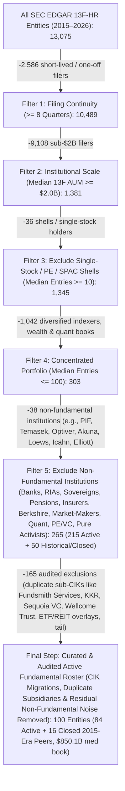

# Research & Engineering Log — 13F Positioning Factors

A structured progress log of our **Point-in-Time (PIT) SEC 13F Positioning Factor & Backtester** pipeline—documenting each step, the real-world data issues encountered, how we solved them, and why. Maintained as a clean reference for the final research memo and technical defense.

---

## 1. Research Framing & Core Scope Decisions

- **Objective & Evaluation Framework:** Build three economically distinct institutional positioning factors directly from SEC 13F filings and test them via a **daily cross-sectional Fama-MacBeth beta-adjusted factor return framework** (regressing next-day beta-adjusted returns $r^{\text{resid}}_{i,t+1} = r_{i,t+1} - \hat{\beta}_{i,t} r_{\text{SPY},t+1}$ on rank-to-Gaussian exposures $z_{i,t}$), paired with a **tradable, drifted T+1 MOC backtest** across `0 / 5 / 10 / 20 bps` one-way transaction costs.
- **Train / Test Split (`~80/20`):**
  - **In-Sample (IS):** `2015-01-01` → `2023-12-31` (9 years / 36 quarters, with `2014` market burn-in for 1-year rolling beta and Q4 2014 baseline for Q1 2015 deltas). Covers ZIRP growth (`2015–19`), COVID (`2020`), meme/retail de-grossing (`2021`), rate-hike crowding unwind (`2022`), and early AI concentration (`2023`).
  - **Out-of-Sample (OOS):** `2024-01-01` → present (~2.9 years, model frozen post-2023). *Rationale:* A <1-year OOS on a quarterly signal has virtually no statistical power ($\text{SE}(\widehat{\text{SR}}) \approx 1.2$); ~3 years tightens SE by ~2× while directly testing modern crowding and alpha decay.
- **Three Positioning Factors (pooled over the same 100-manager universe):**
  1. **Crowding** *(Level / Fragility):* Liquidity- and size-normalized peer concentration (`% shares owned`, Days-to-Liquidate, holder breadth) capturing forced-liquidation left-tail risk.
  2. **Concentration Shifts** *(Conviction Delta):* Active portfolio-weight changes ($\Delta w^{\text{active}}$, stripping out passive price drift) and holder HHI shifts ($\Delta \text{HHI}$).
  3. **Flow-vs-Price Divergence** *(Contrarian Active Flow):* Split-adjusted active institutional buying into drawdowns vs. selling into rallies—directly addressing the Price Momentum (`UMD`) confounder in naive ownership momentum.
- **Equity Universe:** **Seasoned US Common Stocks only** (`is_us_common_stock == True`, excluding REITs, ETFs, ADRs, SPAC units, warrants, and options), with strictly `>= 252` prior trading days before `query_date`, and **dynamic PIT Market Cap & ADV floors** anchored strictly pre-IS on `2014-12-31` at `$1.0B` MCap / `$5.0M` ADV and scaled forward by `SPY`'s trailing 60-day `raw_close` SMA ending `t-1`. *Rationale:* Rejected restricting to S&P 500 constituents (lookahead/survivorship bias + loses mid-cap dispersion) and rejected hardcoded nominal `$2B / $10M` floors (regime drift across a 3.4× equity market appreciation from 2015–2026).

---

## 2. Entity Universe Filtering Flowchart *(SEC-Wide `SUMMARYPAGE` Screen, `2015–2026`)*

Quantitative entity-filtering funnel computed directly across all **47 quarterly SEC Form 13F Data Sets** (`SUBMISSION.tsv`, `COVERPAGE.tsv`, `SUMMARYPAGE.tsv`, [filer_screener.py](../src/ingest/filer_screener.py)), placing curated & audited active-fundamental selection strictly as the **final step**.

- **Why We Expanded From `36 → 100` Entities (and Why We Did Not Blindly Ingest All 265):**
  - *Peer-overlap bottleneck at 36 funds:* Under our initial 36-fund roster, **`56.2%`** of panel-eligible stock-days were held by only 1 fund (`median n_filers = 1`, `n_filers >= 3` only `21.7%` ≈ 80 stocks/day).
  - *Why not all 265 unfiltered:* Spot-checking the raw 265-entity screen surfaced exact data-hygiene traps—duplicate subsidiary `13F-HR`s (`Fundsmith Investment Services`, `$6.4B`), unstitched CIK migrations (`Equity Investment Corp`), and non-fundamental entities bypassing keyword filters (`KKR`, `Sequoia Capital`, `Wellcome Trust`, `Japan Science Agency`, `Edelman`, `Milliman`, `Windhaven`)—while tripling clean-clone runtime to `>30 min`.
  - *Impact of expanding to **100 audited entities** (`30` Growth/TMT L/S, `27` Value/Contrarian, `27` Quality/Generalist, `16` Closed 2015-era peers):*

| Metric (`2015-02-18 → 2026-11-20`) | Initial `36`-Fund Baseline | Expanded `100`-Fund Universe | Improvement |
| --- | ---: | ---: | ---: |
| **Tracked Median Book / 2026 Active Book** | `$339.8B` / `$407.4B` | **`$850.1B` / `$829.3B`** | **2.5× capital** |
| **Closed 2015-Era Anti-Survivorship Peers** | `4` (`11.1%`) | **`16` (`16.0%`)** | Stronger bias guard |
| **Avg Daily Panel-Eligible Stocks** | `368.5 / day` | **`731.5 / day`** | **2.0× breadth** |
| **Single-Fund Stock-Days (`n_filers == 1`)** | `56.2%` *(med = 1)* | **`35.6%` *(med = 2)*** | `-20.6 pp` noise |
| **Multi-Fund Stock-Days (`n_filers >= 3`)** | `21.7%` *(~80/day)* | **`42.0%` *(~307/day)*** | **3.8× crowded names** |
| **High-Overlap Stock-Days (`n_filers >= 5`)** | `7.3%` *(~27/day)* | **`21.1%` *(~154/day)*** | **5.7× deep overlap** |

---

## 3. Step-by-Step Progress, Issues & Solutions

### Step 1 — SEC EDGAR Index, SEC-Wide Screening & 100-Manager Entity Resolution
*Modules:* [edgar_client.py](../src/ingest/edgar_client.py), [master_index.py](../src/ingest/master_index.py), [filer_screener.py](../src/ingest/filer_screener.py), [filers.yaml](../config/filers.yaml), [entity_audit.py](../src/ingest/entity_audit.py), [data_governance.md](data_governance.md)

- **What we built:** Downloaded all **48/48** quarterly SEC `master.idx` files (`2015 Q1 → 2026 Q4`: `308,891` 13F filings across `13,075` CIKs), extracted `SUBMISSION.tsv` + `COVERPAGE.tsv` + `SUMMARYPAGE.tsv` across all **47** SEC Form 13F quarterly data sets via partial HTTP Range reads (~60s total), and built a declarative 100-entity registry (`config/filers.yaml`) verified by `entity_audit.py --strict`.
- **Issue 1 — Pre-2023 1,000× unit errors inside SEC `SUMMARYPAGE.tsv`:** Screening all `13,075` CIKs initially surfaced `$100B–$962B` phantom AUMs (`WestEnd`, `Kahn Brothers`, `Hahn Capital`, `Chartist`, `Delta`) because those managers filed exact `$1` pre-2023 instead of `$1,000s`.
  - *Solution:* Added self-healing average-position-size unit guards in [filer_screener.py](../src/ingest/filer_screener.py), cleanly recovering true institutional scale before ranking the `265`-entity candidate pool ([filer_screening_candidates.csv](../outputs/filer_screening_candidates.csv)).
- **Issue 2 — Filer-level survivorship bias:** Selecting only managers thriving in 2026 biases `2015–2023` results.
  - *Solution:* Retained **16 wound-down / historical 2015-era fundamental peers** (`Blue Ridge`, `Melvin`, `Highfields`, `Tourbillon`, `Eton Park`, `SPO Advisory`, `Omega Advisors`, `Hitchwood`, `Ivory`, `International Value Advisers`, `Vontobel`, `Northern Cross`, `Trilogy`, `Holland`, `Santa Barbara`, `ThomasPartners`). Their `status: closed` tag is documentation-only—never used for lookahead.
- **Issue 3 — Real-world SEC CIK migrations, affiliates, legal renames & hiatuses:**
  - *Solution:* Stitched **5 CIK migrations** via date-bounded `predecessor_ciks` (`Greenlight → DME` at the 2024 OOS split, `Hillhouse → HHLR` capped at `2018-12-31` eliminating 3 overlapping 2019 quarters, `Appaloosa`, `Ruane Cunniff` capped at `2018-05-14`, `TCI` capped at `2015-06-30`); excluded overlapping affiliate `13F-HR` CIKs (`Steadfast`, `Fundsmith`, `Sands`, `Vontobel`, `PointState Season`); tracked **12 same-CIK legal renames** (`Suvretta → Montanova`, `Magellan → Barrenjoey`, `Gardner Russo & Gardner → Quinn`, etc.); and flagged `Blue Ridge`'s 8-quarter hiatus (`2019–2020`).
  - *Result:* **`4,469` deduplicated filings** (`4,219` `13F-HR`, `250` `13F-HR/A`), `0` duplicate quarters, `0` unmapped alias CIKs.

---

### Step 2 — Complete-Submission 13F XML Parsing & Unit Normalization
*Modules:* [filings.py](../src/ingest/filings.py)

- **What we built:** A concurrent 5-worker (`<= 8 req/s`) single-request SGML `.txt` downloader & XML parser caching all `4,469` filings gzipped (offline re-parse takes 7 seconds). *Rationale over bulk `INFOTABLE.tsv` ZIPs:* Bulk ZIPs lag the live `2026 Q4` tail by weeks, omit exact `<ACCEPTANCE-DATETIME>`, and lose raw XML auditability.
- **Issue 1 — Three distinct SEC `<value>` unit-reporting errors caught across 100 entities (`114` filings total):**
  - *Post-2023 reported in `$1,000s` (`×1,000` fix):* e.g., `Baupost` (all 16 post-2023 quarters), `SGA`, `Altimeter`, `Sands`, etc.
  - *Pre-2023 reported in exact `$1` (`÷1,000` fix):* e.g., `Lone Pine`, `EdgePoint`, etc.
  - *Pre-2023 reported in `$1,000,000s` (millions! — caught by `--strict` on our 100-fund expansion):* `Luxor Capital` (`2016-05-16`, restated 30 days later), `Trilogy Global` (`2019-02-08`, final filing never amended), and `Harding Loevner` (`2015-01-12`, restated 2 days later).
  - *Solution:* Strictly PIT within-filing `median(value_raw / ssh_prnamt)` sanity band `[$1, $5,000]` handling all three error modes (`114` auto-corrected, **`0` remaining unit-suspect**).
- **Issue 2 — Persistent EDGAR HTTP `502`s & wind-down placeholder rows:** Automatic `index.json` + `.hdr.sgml` + XML directory fallback rescued every HTTP `502` `.txt` failure; stripped dummy `cusip == 000000000` / `0`-share rows while tagging `25` wind-downs as `zero_holdings`.
- **Result:** `4,469 / 4,469` filings parsed (`4,444 ok`, `25 zero_holdings`, `0` errors, **`0` cross-filer `<otherManagers>` overlaps**) → **`240,386` raw holding rows** across `6,151` unique long-`SH` CUSIPs (`211 RESTATEMENT` + `39 NEW HOLDINGS` amendments).

---

### Step 3 — Security Mapping (OpenFIGI), Market Prices (`yfinance`) & PIT Shares (`SEC companyfacts`)
*Modules:* [cusip_mapper.py](../src/ingest/cusip_mapper.py), [cusip_overrides.yaml](../config/cusip_overrides.yaml), [market_data.py](../src/ingest/market_data.py), [shares_outstanding.py](../src/ingest/shares_outstanding.py), [run_pipeline.py](../src/run_pipeline.py)

- **CUSIP → Persistent `security_id` Mapping (`cusip_figi_map.parquet`):**
  - Routed letter-prefixed international CINS codes to `idType: "ID_CINS"`, applied second-pass `shareClassFIGI` stitching for retired US CUSIPs (`Priceline → BKNG`, `UTX → RTX`, `old GE → GE`), plus **13** verified overrides in [cusip_overrides.yaml](../config/cusip_overrides.yaml) (including `TEL`'s 2024 Swiss→Irish re-domicile).
  - *Result:* **`99.39%`** of tracked 13F dollars mapped (`5,649 / 6,151` CUSIPs); **`4,060` US Common Stock CUSIPs → `3,861` persistent `security_id`s (`87.06%` of total dollars; `194` CUSIP-change stitches)**, cleanly excluding ADRs, REITs, ETFs, and Warrants/Units.
- **Market Data (`market_prices.parquet`, `spy_prices.parquet`):**
  - Upgraded `market_data.py` to **ticker-level incremental caching** so expanding `36 → 100` entities reused all `1,168` previously cached tickers without re-querying Yahoo Finance.
  - Downloaded `2014-01-01 → 2026-11-20` (`auto_adjust=False, actions=True`), mathematically un-split `Close`, `Volume`, and `Dividends` ($P^{\text{raw}}_t = P^{\text{sadj}}_t \cdot F_{\text{fut}}(t)$), and verified un-split `raw_close` to the penny against historical 13F implied prices:

| Ticker | Cumulative Splits Since Report | Reconstructed `raw_close` | 13F Implied Price (`value / shares`) | Difference |
| --- | ---: | ---: | ---: | ---: |
| `NVDA` | `40×` (4:1 + 10:1) | `$522.20` | `$522.20` | `$0.00` |
| `AMZN` | `20×` (20:1) | `$3,256.94` | `$3,256.93` | `$0.01` |
| `GOOGL` | `20×` (20:1) | `$1,752.64` | `$1,752.64` | `$0.00` |
| `NFLX` | `10×` (10:1) | `$540.73` | `$540.73` | `$0.00` |

  - *Coverage & Survivorship (`market_data_survivorship_report.csv`):* **`2,011` tickers priced (`5.18M` rows, `92.04%` of US Common Stock 13F dollars)**; `5.12%` are delisted/acquired (`ATVI`, `TWTR`, `SPLK`, `PXD`, `WBA`, `AET`, `CELG`, etc.) and `2.84%` are dead Bloomberg numeric IDs.
- **PIT Shares Outstanding (`shares_outstanding_pit.parquet`):**
  - Concurrent SEC EDGAR `companyfacts` XBRL loader extracted **`321,189` PIT share-count rows across `2,286` tickers (`90.79%` of queryable US Common Stock dollars)**.
  - *Issue discovered during 100-fund QA:* **60 real SEC XBRL facts across 50 tickers** contained future-dated typo `end_date > filed_date` (e.g., `AAL` filed `end_date = 2027-07-17` on `2026-07-23`). *Solution:* Added a strictly PIT `end_date <= filed_date` filter in [panel.py](../src/pit/panel.py).
  - *Known flat-JSON gap:* Dimensional multi-class XBRL issuers (`Visa V`, `FWONK`, `BRK-A/B`, `STZ`) remain excluded from mcap/ownership-gated signals and logged in Section 5.

---

### Step 4 — Point-in-Time (PIT) Append-Only 13F Holdings Ledger
*Modules:* [ledger.py](../src/pit/ledger.py), [test_pit_ledger.py](../tests/test_pit_ledger.py)

- **What we built:** Immutable versioned PIT state engine (`PitHoldingsLedger`) enforcing strict **T+1 trading-day visibility** (`effective_date = next_trading_day(max(date_filed, acceptance_date))` on the `SPY` calendar)—guaranteeing `filing_date < query_date` on every row.
- **Real SEC `13F-HR/A` traps solved across all `250` amendments:**
  - *Retroactive amendments of older quarters:* Versioned per `(filer_id, period_of_report)` with `[valid_from, valid_to)`; `get_latest_holdings(query_date)` picks `max(period_of_report)` so restatements of older quarters never revert a fund's current book.
  - *Cumulative vs. incremental `NEW HOLDINGS` (CTR reveals):* `RESTATEMENT` replaces the quarter table; `NEW HOLDINGS` upserts by CUSIP—preventing share doubling on cumulative filings while cleanly surfacing incremental CTR reveals (**`99` CTR reveal holding rows tagged**).
  - *Closed-fund hygiene:* `zero_holdings` filings clear books immediately; `max_staleness_days=160` retires ceased filers strictly PIT once they miss the next quarterly window.
- **Verification:** Materialized `pit_13f_states.parquet` (`4,449` states) & `pit_13f_holdings_events.parquet` (`218,296` rows). Automated QA verified **249 / 249** amended state T vs. T+1 visibility boundaries and 47 historical query dates with zero lookahead.

---

### Step 5 — Stage 1 Security Aggregation & Stage 2 PIT Market Data / Split Alignment
*Modules:* [panel.py](../src/pit/panel.py), [test_pit_panel.py](../tests/test_pit_panel.py)

- **What we built:** Separated **Stage 1** (pure 13F security mapping, CUSIP stitching, aggregation) from **Stage 2** (`PitMarketStore`, joining close prices, forward-only adjusted `spy_adj_close`, split-aligned shares, PIT XBRL shares outstanding, `pit_mcap_usd`, and dynamic seasoned universe gates).
- **Issue 1 — Stock splits straddling filings distort BOTH sums and ownership ratios:**
  - *Empirical rules verified:* 13F holdings are reported on **`period_of_report` (pre-split)** basis (`152 / 156` straddling rows) $\Rightarrow$ forward-adjust each filer strictly in `(period_of_report, query_date]` before summing. Under GAAP ASC 260, XBRL `shares_outstanding` with `end_date < split_date <= filed_date` is **already restated to `filed_date` (post-split)** basis (`100%` of verified splits) $\Rightarrow$ forward-adjust strictly in `(filed_date, query_date]`, using $k = F_{\text{fut}}(\text{from}) / F_{\text{fut}}(t)$ so all future splits strictly after `query_date` cancel identically.
  - *Proof 1 — Real Cross-Filer Split Straddling Caught (100-Fund Universe):*

| Query Date | Ticker | Filers | Naive Raw Share Sum | Split-Aligned `total_shares_owned_pit` | Error Prevented |
| --- | --- | ---: | ---: | ---: | ---: |
| `2022-11-10` | `GOOG` | 31 | `62.60M` | `216.84M` | **3.46×** |
| `2022-11-10` | `GOOGL` | 39 | `28.55M` | `120.61M` | **4.22×** |
| `2024-08-12` | `NVDA` | 22 | `35.25M` | `295.10M` | **8.37×** |

  - *Proof 2 — Real Split Ex-Date Continuity (`T-1` vs. Split Ex-Date `T`, 100-Fund Universe):*

| Ticker | `T-1` → `T` | Split | Filers | `raw_close` | `pit_mcap` (\$B) | `mcap_ret` | True `ret` | `pct_owned` (`T-1` → `T`) |
| --- | --- | ---: | ---: | --- | --- | ---: | ---: | --- |
| `AAPL` | `2020-08-28` → `08-31` | `4:1` | 16 | `$499.23` → `$129.04` | `2,134.5` → `2,206.9` | `+3.39%` | `+3.39%` | `0.3299%` → `0.3299%` |
| `AMZN` | `2022-06-03` → `06-06` | `20:1` | 46 | `$2,447.00` → `$124.79` | `1,244.8` → `1,269.7` | `+1.99%` | `+1.99%` | `2.1118%` → `2.1118%` |
| `GOOGL` | `2022-07-15` → `07-18` | `20:1` | 35 | `$2,235.55` → `$109.03` | `1,472.7` → `1,436.5` | `-2.46%` | `-2.46%` | `2.6704%` → `2.6704%` |
| `NVDA` | `2024-06-07` → `06-10` | `10:1` | 23 | `$1,208.88` → `$121.79` | `2,973.8` → `2,996.0` | `+0.75%` | `+0.75%` | `1.2036%` → `1.2036%` |

- **Issue 2 — Nominal threshold drift & forward-only `SPY` benchmark:**
  - *Solution:* Compounded `spy_adj_close` strictly **forward** from `2014-01-02` (invariant to future dividends). Replaced fixed `$2B / $10M` floors with dynamic PIT thresholds anchored strictly pre-IS on `2014-12-31` at **`$1.0B` MCap / `$5.0M` ADV** and scaled strictly forward by `SPY`'s trailing 60-day `raw_close` SMA ending `t-1` (zero lookahead).
- **Issue 3 — Stale XBRL & unequal dual-class shares (`BRK-A/B`):** Enforced `shares_out_age_days <= 460` and auto-detected unequal sibling price ratios (`>= 2.5x`) strictly PIT to null bogus market caps (`BRK-B`).
- **PIT Seasoned Investable Universe Funnel — Dynamic `SPY`-Scaled Floors (100-Fund Universe, `2015–2026`):**

| Query Date | `SPY` Mult | Dynamic Floor (MCap / ADV) | US Common Held | Priced | Seasoned (`>=252d`) | Passes MCap | Passes ADV | **Panel Eligible** |
| --- | ---: | --- | ---: | ---: | ---: | ---: | ---: | ---: |
| `2015-03-02` | `1.02×` | `$1.02B` / `$5.1M` | 1,301 | 731 | 702 | 603 | 659 | **581** |
| `2018-05-16` | `1.33×` | `$1.33B` / `$6.7M` | 1,293 | 872 | 850 | 727 | 775 | **698** |
| `2021-05-18` | `2.00×` | `$2.00B` / `$10.0M` | 1,441 | 1,050 | 978 | 852 | 906 | **795** |
| `2024-08-16` | `2.69×` | `$2.69B` / `$13.5M` | 1,287 | 1,122 | 1,101 | 850 | 931 | **815** |
| `2026-05-18` | `3.42×` | `$3.42B` / `$17.1M` | 1,335 | 1,174 | 1,139 | 834 | 1,015 | **802** |

---

### Step 6 — Stage 3 Backwards/Forward Compute & Full Daily PIT Panel Materialization
*Modules:* [compute.py](../src/pit/compute.py), [daily_panel.py](../src/pit/daily_panel.py), [test_pit_compute.py](../tests/test_pit_compute.py)

- **What we built:** Stage 3 compute layer (`Stage3MarketMetrics`, `attach_stage3_compute`, `build_pit_stage3_snapshot`) and vectorized regime-block panel builder (`build_daily_pit_panel`) materializing `data/processed/pit_daily_panel.parquet` (`2,983` US trading days `2015-01-13 → 2026-11-20`, `3,862,137` total rows, **`2,167,760` panel-eligible rows**, avg **`731.5` stocks/day** post-Feb 2015).
- **Lagged Trailing 252-Day Masked OLS Beta (`beta_252d_lag1`, strictly `[t-252, t-1]`, excluding `query_date`):**
  - Masked `SPY` returns to exact stock-valid return dates (`min_periods=250`), matched independent `np.polyfit` to `<= 1.33e-15`, and verified realized next-day hedge accuracy across the 100-fund panel (`~2,959` days): equal-weighted universe realized beta drops from **`1.0558` → `+0.0164`** (**`98.4%`** of market beta removed). Kept **raw OLS beta** (Blume shrinkage logged in Section 5):

| Date | `n` (`Panel Eligible`) | Min (`Ticker`) | `p05` | **Median** | `p95` | Max (`Ticker`) |
| --- | ---: | --- | ---: | ---: | ---: | --- |
| `2015-02-18` | 574 | `-0.102` (`NG`) | `0.588` | **`1.081`** | `1.723` | `2.697` (`GBX`) |
| `2018-05-16` | 698 | `-0.027` (`KGC`) | `0.348` | **`0.920`** | `1.466` | `1.976` (`LRCX`) |
| `2020-05-18` | 739 | `-0.165` (`ZM`) | `0.579` | **`1.097`** | `1.628` | `2.321` (`LNC`) |
| `2022-05-17` | 795 | `+0.030` (`NEM`) | `0.262` | **`1.012`** | `2.071` | `3.502` (`AFRM`) |
| `2024-08-16` | 815 | `-0.147` (`GIS`) | `0.235` | **`0.954`** | `2.034` | `3.688` (`SMCI`) |
| `2026-05-18` | 802 | `-0.564` (`KR`) | `-0.042` | **`0.978`** | `2.584` | `4.845` (`HUT`) |

- **Split-Neutral QoQ Share Changes & Active Portfolio-Weight Shifts:** Paired each active filer's `Q_curr` with consecutive `Q_prev` (`gap <= 105d`, excluding `>75%` fund wind-down collapses, capturing full exits), forward-adjusted both quarters to `query_date` share units before differencing, and valued both books at constant `raw_close[t]` so passive price drift cancels identically to `0.0000`.
- **Dual-Class Rollup & Primary Class Deduplication (`2024-08-16`, 100-Fund Universe):** Rolled up equal-ratio sibling ownership, flows, position dollars, and ADV by `issuer_cik`, enforced `pct_shares_owned <= 1.0`, and kept only the single highest-ADV primary class (`is_primary_class`):

| Ticker (`2024-08-16`) | `issuer_cik` | Filers | 20d ADV | Class `% Owned` | Rolled-Up `% Owned` | `is_primary_class` | `is_panel_eligible` |
| --- | --- | ---: | ---: | ---: | ---: | --- | --- |
| `GOOGL` | `0001652044` | 36 | `$5,218M` | `0.699%` | **`1.662%`** | `True` | `True` |
| `GOOG` | `0001652044` | 33 | `$3,421M` | `0.963%` | `1.662%` | `False` | `False` |
| `FOXA` | `0001754301` | 2 | `$98.5M` | `4.393%` | **`7.259%`** | `True` | `True` |
| `FOX` | `0001754301` | 2 | `$32.0M` | `2.866%` | `7.259%` | `False` | `False` |
| `NWSA` | `0001564708` | 4 | `$81.5M` | `6.799%` | **`8.518%`** | `True` | `True` |
| `NWS` | `0001564708` | 3 | `$16.8M` | `1.719%` | `8.518%` | `False` | `False` |

- **Close-to-Close Return Alignment (`prev_day_ret` `t-1 → t`, `fwd_day_ret` `t → t+1`) & Bit-for-Bit Parity:**
  - Strictly scrubbed to the `3,242` US trading days in `spy_prices.parquet` (`0` weekends, `cal_step == 1`). Across all **`2,162,069`** consecutive panel-eligible stock-day pairs, `max |fwd_day_ret(t) - prev_day_ret(t+1)| = 0.00e+00` and `max |fwd_spy_ret(t) - prev_spy_ret(t+1)| = 0.00e+00`, preserving exact corporate-action total returns (`AAPL` 4:1 `+3.391%`, `GE` 1:8 reverse `-2.896%`, `AMZN` 20:1 `+1.994%`, `NVDA` 10:1 `+0.746%`, `MSFT` `$0.75` Ex-Div `+1.180%`).
  - Bit-for-bit parity verified across all 6 stress-test dates on the 100-entity panel (and caught/fixed an unpriced-ticker `delta_shares_raw` fallback on `NCI`):

| Verification Date | Stress Scenario | Rows Checked | `panel_eligible` | Max Relative Error | Status |
| --- | --- | ---: | ---: | ---: | --- |
| `2015-05-18` | First QoQ delta wave | 1,325 | 595 | `6.54e-13` | **EXACT** |
| `2020-08-31` | `AAPL` 4:1 split ex-date | 1,254 | 740 | `6.78e-14` | **EXACT** |
| `2022-11-10` | `GOOG`/`GOOGL` 20:1 straddle | 1,399 | 811 | `1.73e-14` | **EXACT** |
| `2024-06-10` | `NVDA` 10:1 split ex-date | 1,293 | 821 | `4.89e-15` | **EXACT** |
| `2024-08-12` | `NVDA` 10:1 split straddle | 1,285 | 814 | `2.82e-15` | **EXACT** |
| `2024-08-16` | Post-Q2 wave + dual-class | 1,287 | 815 | `1.71e-14` | **EXACT** |

---

## 4. Current Verification Status

- **Tests:** `pytest` — **42 passed** (unit + adversarial PIT lookahead, corporate-action return, calendar-scrubbing, and 100-filer config validation tests).
- **Lint:** `ruff check .` — **All checks passed**.
- **Next Milestone:** Resume **Phase 3 (`src/factors/`)** on our 100-entity enriched daily panel (`2.17M` panel-eligible rows, avg `731.5` stocks/day)—building **Crowding** (with `pct_shares_owned` ablation), **Concentration Shifts**, and **Flow-vs-Price Divergence** strictly In-Sample (`2015–2023`), followed by **Phase 4 (`src/backtest/`)** and **Phase 5 (`memo/` & clean-clone verification)**.

---

## 5. What We Would Build Next *(Living Backlog)*

Append-only tracker of deliberate scope cuts and real data limitations surfaced during development, feeding directly into the final research memo.

- **[Data] Institutional Delisted-Return Database (CRSP / Compustat):** Free Yahoo Finance drops `5.12%` of US Common Stock 13F dollars in acquired/delisted names (`ATVI`, `TWTR`, `SPLK`, `PXD`, `WBA`, `AET`, `CELG`, `ALXN`). Replacing `yfinance` with CRSP delisting-adjusted returns would eliminate residual survivorship bias completely.
- **[Data] Inline-XBRL / Institutional Share-Count Feed:** SEC's flat `companyfacts` JSON strips dimensional multi-class share counts (`Visa V`, `FWONK`, `BRK-A/B`, `STZ`) and contains occasional issuer date typos (`60` future-dated `end_date > filed_date` rows scrubbed). Parsing inline-XBRL cover pages or using Compustat/CRSP shares would recover ~100% coverage.
- **[Signal] Activist 13D & M&A Event-Layer Integration:** Pure activist funds (`Icahn`, `Elliott`, `Third Point`, `ValueAct`, `Starboard`) were deliberately excluded because Schedule 13D filings (10-day window) and press leaks front-run Day-45 13Fs, and announced M&A targets trade like cash deal-spreads. Adding a PIT 13D feed and merger-announcement scrub would unlock clean activist conviction signals.
- **[Scale] Automated Form ADV Scaling Beyond 100 Audited Entities:** Scaling to all ~200–500 fundamental hedge funds requires Form ADV / FactSet investor-type metadata + automated affiliate-CIK resolution (to avoid duplicate subsidiaries like `Fundsmith Investment Services` and PE/VC/endowment leakage) paired with SEC quarterly bulk `form13f.zip` backfills.
- **[Risk / Attribution] Multi-Factor & Sector Neutralization:** Current evaluation isolates `SPY` market-beta-adjusted returns. Adding Kenneth French FF5 + Momentum (`UMD`) regressions and GICS sector neutralization would cleanly separate pure positioning alpha from style/sector tilts.
- **[Risk / Hedging] Blume / Vasicek Beta Shrinkage:** Raw 252-day lagged OLS beta removes `98.4%` of aggregate universe market beta (`1.0558 → +0.0164`), but shows classic estimation-noise mean-reversion in the extremes (`Q1`/`Q5` ~`±0.10`). Standard zero-lookahead Blume shrinkage (`0.67 * beta_ols + 0.33 * 1.0`) would tighten tail-quintile neutrality.
- **[Crowding Depth] Short Interest, Prime-Broker Borrow & Options Overlays:** Form 13F reports only long US equities (no shorts, swaps, or non-US positions). Combining FINRA bi-monthly short interest, borrow utilization, and 13F `PUT`/`CALL` overlays would capture two-sided squeeze and de-grossing risk.
