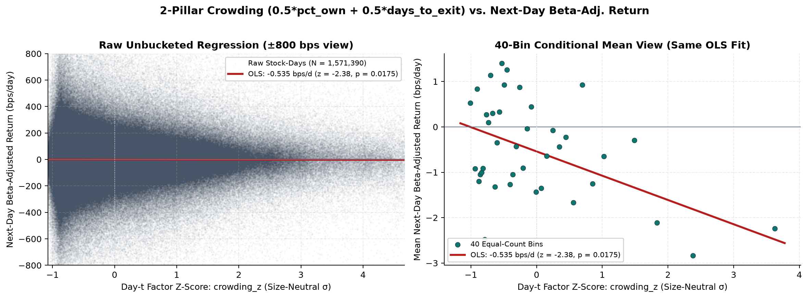
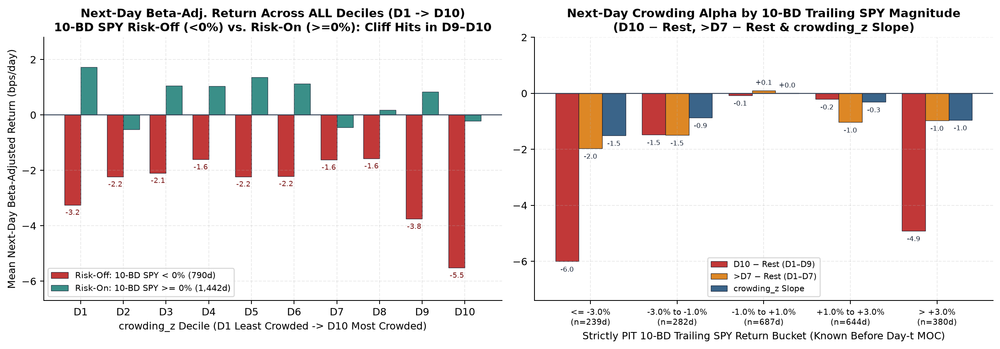

# Research Memo: Point-in-Time SEC 13F Institutional Positioning Factors

**Date:** November 22, 2026  
**Sample:** In-Sample `2015–2023` | Frozen OOS `2024–Nov 2026`  
**CLI:** `python -m src.run_pipeline --stage all`  
**Companion Artifacts:** Pre-executed notebook ([`notebooks/factor_research.ipynb`](../notebooks/factor_research.ipynb)), engineering audit log ([`docs/research_log.md`](../docs/research_log.md)), entity governance ([`docs/data_governance.md`](../docs/data_governance.md)), 65 automated QA & adversarial PIT tests (`tests/`).

---

## 1. Factor Hypothesis & Summary of Findings

SEC Form 13F filings disclose US institutional long equity holdings with a statutory **45-day** lag (and later via amendments). Because trades are **45–135 days** old by publication, a defensible 13F signal must explain why predictive power survives the delay. Across our **100-manager** institutional universe, we tested four hypotheses spanning structural crowding, quarterly flow shifts, and two forms of smart-money following.

- **Validated Signal — Two-Pillar Crowding (`crowding_z`):**
  - Equal-weight composite of two size-neutralized exit-congestion metrics: share of float held by our institutional universe (`pct_own`) and days of 20-day average volume needed to liquidate (`days_to_exit`).
  - *Why it survives the 45-day lag:* Institutional positions unwind slowly. Stock-level crowding rankings barely move over a quarter (1-quarter rank correlation **`+0.95`**), so congestion disclosed on Day +45 still describes the live shareholder base. During macro stress or rotations, synchronized de-grossing through narrow liquidity exits drives asymmetric selling pressure.
  - *Decile notation:* Eligible stocks are sorted daily into ten equal-count deciles from Decile 1 (`D1`, least crowded) to Decile 10 (`D10`, most crowded); `>D7` (`D8–D10`) denotes the top **30%** most crowded. Because drag concentrates in the extreme tail, we also test `D10 − D1–D9` (short the top decile against a diversified long basket of the remaining **90%**) to isolate the crowded-tail spread while removing market and SPY-vs-mid-cap basis risk.
- **Three Alternatives Tested & Rejected In-Sample:**
  - *Concentration Shifts (`delta_pct_own`):* **Hypothesis:** quarter-over-quarter active ownership increases should signal fresh fundamental conviction. **Result:** flat (**`p = 0.817`**); quarterly flows barely persist (1Q corr **`+0.17`**) and are already priced in by Day +46.
  - *Naive Smart Money (Report-Date Dollars):* **Hypothesis:** stocks holding the largest aggregate institutional dollars (valued strictly at each filing's report date) should capture high-conviction consensus ideas. **Result:** flat (**`p = 0.442`**); raw dollars are size-confounded (**`corr = +0.57`**) and size-neutral log dollars reduce to a noisier proxy for `pct_own` (**`corr = +0.70`**).
  - *Manager-Skill Smart Money (8-Quarter Static `IR_badj`):* **Hypothesis:** weighting live positions by each manager's trailing 8-quarter beta-adjusted Information Ratio—frozen on completed prior quarters to strip out market beta and intra-quarter momentum—should separate skilled stock-pickers from asset-gatherers. **Result:** flat (**`p = 0.951`**); 1-quarter manager persistence is near zero (**`Rank IC = +0.034`**) and 2-year rankings suffered Growth-vs-Value whipsaw across 2020–2023.

| Headline Summary (Buffered 25 bps, 5 bps/side) | Train (IS 2015–2023) | Frozen OOS (2024–2026) | Key Economic Takeaway |
|---|---:|---:|---|
| **Pure `crowding_z` Factor Slope (OLS)** | **`-0.535 bps/d` (`p=0.0175`)** | **`-0.556 bps/d` (`p=0.232`)** | Tail `D10−Rest`: `-1.74 bps/d` (`p=0.0061`) IS; stable slope OOS |
| Short `>D7` vs. SPY Beta Hedge | SR **`+0.49`** \| Ret `+3.99%` \| DD `-23.1%` | SR **`+0.68`** \| Ret `+6.20%` \| DD `-10.5%` | OOS = ~**3.8%** pure crowding alpha + ~**2.4%** SPY/mid-cap basis |
| Dollar & Beta-Neutral `D10 / D1–D9` | SR **`+0.55`** \| Ret `+1.46%` \| DD `-4.7%` | SR **`-0.04`** \| Ret `-0.13%` \| DD `-5.0%` | 5× lower DD IS; flat OOS as `D10` crowding fell **34%** & drag hit `D8–D9` |

---

## 2. Scope Decisions & Deliberate Exclusions

We bounded scope to assemble a diverse, representative cohort of concentrated fundamental institutional investors—suitable for testing crowding, flow shifts, and manager skill cleanly—with strict point-in-time hygiene and a ~**15–20 minute** cold-clone runtime.

| Dimension | Chosen Scope | Alternatives Considered & Why Excluded |
|---|---|---|
| **Institutional Universe** (`config/filers.yaml`) | • **100** audited fundamental equity institutions across Growth/TMT, Value, and Quality styles (**84** active + **16** closed 2015-era peers; **`$850.1B`** median book). • Screened from **13,075** EDGAR filers via continuity (`>= 8Q`), scale (`>= $2B`), and concentration (`10–100` holdings). | • *Passive indexers (Vanguard, BlackRock):* Dilute active positioning signals with benchmark weights. • *Quant, market-makers & pod shops (Citadel, RenTech, Millennium):* Fast turnover and internal netting make 45-day snapshots stale. • *Pure 13D activists & Berkshire Hathaway:* 10-day 13Ds front-run Day 45; Berkshire distorts dollar aggregates. • *Unfiltered 265-filer raw screen:* Admits duplicate sub-CIKs and PE/VC/endowment noise. |
| **Equity Universe** (`src/pit/panel.py`) | • Seasoned (`>= 252` prior trading days) US Common Stocks only (avg **731.5** stocks/day). • Dynamic PIT floors anchored pre-IS (`2014-12-31`) at **`$1.0B`** MCap / **`$5.0M`** 20d ADV, scaled forward by SPY's trailing 60-day SMA ending `t-1`. | • *Options (PUT/CALL), ADRs, REITs, ETFs, SPAC units & IPOs:* Different microstructure, payout mechanics, or missing 1-year beta history. • *Fixed benchmark index membership:* Introduces historical constituent lookahead and removes mid-cap crowding dispersion. • *Static nominal floors (`$2B/$10M`):* Causes severe universe drift across **3.4×** market appreciation over 2015–2026. |
| **Sample Split** (`config/settings.yaml`) | • Train (IS): `2015-01-01` to `2023-12-31` (**9 yrs**, **2,232** signal days; 2014 burn-in). • Frozen OOS: `2024-01-01` to `2026-11-20` (**2.9 yrs**, **726** days), guarded on realized `fwd_ret_date <= 2023-12-31`. | • *Shorter `< 1`-year OOS holdout:* Almost no statistical power on a quarterly signal (Sharpe SE `> 1.0`); ~3 years halves SE (~**0.59**) and tests modern AI/concentration markets. • *Pre-2015 history:* Pre-XML EDGAR text parsing adds engineering fragility for older market structure. |
| **Hedging & Costs** (`src/backtest/engine.py`) | • Daily beta hedge vs. SPY via lagged 252-day stock beta (plus a dollar-neutral long/short book). • **5 bps**/side (**10 bps** RT) on drifted trades, **1 bp** on SPY hedges, and short-borrow grid (**0–250 bps/yr**). | • *Multi-factor risk model (FF5 + Momentum + GICS):* Deferred to keep the pipeline transparent on public data; SPY vs. mid-cap basis is diagnosed explicitly in OOS attribution. • *Live prime-broker stock-loan locates:* Requires paid vendor data; modeled via breakeven borrow and prioritized #1 in Section 5. |

---

## 3. Data Engineering, Point-in-Time Discipline & Methodology

### 3.1 Ingestion Hygiene & Point-in-Time Guardrails (65 Automated QA Tests)

Most errors in 13F research hide in entity duplication, XML scale typos, retroactive amendments, and split mismatches. Table 1 summarizes our automated PIT engineering guards; Table 2 verifies split alignment on real historical events.

| Pipeline Stage | Volume & Coverage | PIT Hygiene & Real-World Edge Cases Resolved |
|---|---|---|
| **Filer Dedup & CIK Audit** (`entity_audit.py --strict`) | **308,891** index rows → **4,469** filings (**4,219** HR, **250** HR/A); **0** dup quarters | Stitched **5** date-bounded CIK migrations (Greenlight→DME, Ruane Cunniff, TCI, Hillhouse→HHLR, Appaloosa); excluded overlapping affiliates (Steadfast UK, Fundsmith Services, Sands Ventures); **0** cross-filer `<otherManagers>` overlaps; **16** closed peers retained strictly non-operationally. |
| **XML Parsing & Units** (`filings.py`) | **114** filings unit-corrected; **0** suspect rows remaining | Parsed raw SGML `.txt` submissions (exact `<ACCEPTANCE-DATETIME>`, HTTP 502 directory fallback). Auto-corrected 3 SEC `<value>` unit bugs strictly PIT via within-filing median implied-price bands (`$1,000s` post-2023 Baupost; `$1` pre-2023 Lone Pine; `$1M` pre-2023 Luxor/Trilogy/Harding Loevner). |
| **CUSIP & Dual-Class Map** (`cusip_mapper.py`) | **99.39%** of 13F $ mapped; **3,861** US Common IDs (**194** stitches) | Mapped via OpenFIGI (`ID_CUSIP`, `ID_CINS`, `shareClassFIGI` + **13** overrides in `cusip_overrides.yaml`, e.g., Priceline→BKNG, UTX→RTX). Rolled up equal-ratio dual-class issuers (GOOGL/GOOG, FOXA/FOX, NWSA/NWS) by issuer CIK, keeping only the highest-ADV primary share class. |
| **PIT Ledger: `13F-HR/A` & Confidential Treatment (CTRs)** (`ledger.py`) | **249/249** amended `T` vs. `T+1` boundaries verified; **99** CTR reveals | Versioned `(filer_id, period_of_report)` over `(valid_from, valid_to)` with `effective_date = next_trading_day(max(date_filed, acceptance_date))`, guaranteeing `filing_date < query_date`. `RESTATEMENT` replaces its quarter without reverting newer books; `NEW HOLDINGS` upserts by CUSIP; `zero_holdings` clears immediately and a **160-day** staleness rule retires ceased filers PIT. |
| **Splits, XBRL & Beta QA** (`panel.py`, `compute.py`) | **3.86M** panel rows; parity **`<= 6.54e-13`**; **98.4%** SPY β removed | Forward-adjusted 13F shares from `period_of_report` (**152/156** pre-split) and GAAP ASC 260 XBRL shares from `filed_date` (**100%** post-split) via `k = F_fut(from)/F_fut(t)`. Scrubbed **60** future XBRL dates, **1,571** XBRL unit outliers (**0.49%**) strictly PIT at `<= filed_date`, and **80** Yahoo reorg splices (e.g., CHRD `+25,733%`) inside lagged 252-day masked OLS beta. |

| Real Split Ex-Date / Straddle Verification | Event | Filers | Naive Sum / Raw Close | PIT Split-Aligned Value | Integrity Proof |
|---|---|---:|---:|---:|---:|
| `2024-08-12` NVDA (Cross-Filer Straddle) | 10:1 Split | 22 | `35.25M sh` (mixed) | **`295.10M sh`** | **`8.37×`** error prevented |
| `2022-11-10` GOOGL (Cross-Filer Straddle) | 20:1 Split | 39 | `28.55M sh` (mixed) | **`120.61M sh`** | **`4.22×`** error prevented |
| `2020-08-28 → 08-31` AAPL (Ex-Date Continuity) | 4:1 Split | 16 | `$499.23 → $129.04` | `pct_own`: **`0.3299% → 0.3299%`** | MCap ret `+3.39% == true` |
| `2024-06-07 → 06-10` NVDA (Ex-Date Continuity) | 10:1 Split | 23 | `$1,208.88 → $121.79` | `pct_own`: **`1.2036% → 1.2036%`** | MCap ret `+0.75% == true` |

### 3.2 Factor Construction & Rack-Based Backtester
- **Phase 3 — Pure Econometric Validation:** Daily 1%/99%-winsorized z-scores orthogonalized against `log(pit_mcap_usd)`, evaluated via date-clustered panel OLS (`fwd_beta_adj_ret_bps ~ const + z_sn`). Because `pct_own_sn` (**`-0.558 bps/d`**, `p=0.067`) and `days_to_exit_sn` (**`-0.441 bps/d`**, `p=0.030`) share **`corr = +0.761`** (**`VIF = 2.37`**), unconstrained multilinear OLS inflates SEs **2.3–2.9×**; equal-weight `crowding_z` estimates zero free weights and lifts precision to **`-0.535 bps/d`** (**`z = -2.38, p = 0.0175`**).
- **Phase 4 — Rack-Based T+1 MOC Backtester (`src/backtest/engine.py`):** Sizes any `(date × security_id)` expected-return rack at `N* = clip($50k × r_hat, ±5% ADV_20d)` using the frozen IS slope (**`-0.5348 bps/d`**). Held notionals drift daily via corporate-action-clean `prev_day_ret`; trades pay **5 bps**/side (**10 bps** RT) on `|N_t − N_drift_t|` + **1 bp** on net SPY hedges (`H_t = −Σ N_i β_i`). Benchmarked Daily, Buffered (**±20%** per-position trade-to-boundary band + **±2%** GMV net-dollar guard), and Fixed Quarterly (Day +46).
- **MOC Execution Timing Discipline:** All filing inputs (`13F-HR`, `13F-HR/A`, XBRL shares) and rolling `SPY` betas enforce strict `T+1` lags (`filed < t`, beta over `[t-252, t-1]`) because EDGAR submissions arrive intraday/after-hours. Live market inputs (`raw_close`, `adv_20d`, `spy_ret_10d`) use day-`t` session prices to form day-`t` MOC orders earning `(t → t+1]` — actionable via ~15:45 ET live snapshots ahead of 15:50/15:55 ET exchange MOC cutoffs (and `crowding_z` itself is invariant to lagging all market inputs a full day to `t-1`: **`-0.545 bps/d`**, `p = 0.0161`, while both locked OOS books are strictly unconditional with zero `SPY` regime triggers).

---

## 4. Empirical Results: Signal, Noise & Out-of-Sample Evaluation

### 4.1 Phase 3 — Four-Signal In-Sample Validation Matrix (2015–2023, Zero OOS)

| Candidate Signal (Size-Neutral) | 1Q Corr | Slope | SE | z-stat | p-val | R² (Panel) | Tail Spread (p) | Decision |
|---|---:|---:|---:|---:|---:|---:|---:|---|
| **1. Crowding (`crowding_z`, 2-Pillar)** | **`+0.947`** | **`-0.535`** | **`0.225`** | **`-2.38`** | **`0.0175`** | **`6.71e-06`** | **`D10−Rest: -1.74` (`0.0061`)** | **VALIDATED** |
| 2. Concentration Shifts (`delta_pct_own`) | `+0.165` | `-0.055` | `0.237` | `-0.23` | `0.8166` | `6.99e-08` | `D10−Rest: -0.23` (`0.477`) | REJECTED (stale) |
| 3a. Smart Money (`log_dollars_rpt_sn`) | `+0.880` | `-0.246` | `0.320` | `-0.77` | `0.4416` | `1.42e-06` | `D10−Rest: -1.08` (`0.130`) | REJECTED (proxy) |
| 3b. Manager Skill (`skill_conv_sn`, 8Q IR) | — | `-0.044` | `0.722` | `-0.06` | `0.9509` | `4.38e-08` | `D10−D1: -0.44` (`0.846`) | REJECTED (noise) |

*Skepticism on R² vs. Directional Alpha:* A single-stock daily R² of **`6.71e-06`** explains virtually zero single-stock variance (daily idiosyncratic vol σ ≈ **206 bps/d**)—warranting genuine skepticism, as crowding cannot forecast individual daily moves and leaves small baskets exposed to single-name spikes. Yet the low p-value (**`p = 0.0175`**; `D10 − Rest` **`p = 0.0061`**) should not be discredited: for a standardized daily factor, `R² ≈ (slope / σ)² = (0.535 / 206.3)²`, so real directional alpha looks microscopic per stock (~**100×** above rejected signals at **`4–7e-08`**) and must be harvested across broad, diversified portfolios. Alternative proxies were equally flat (active Δw `p=0.365`, ΔHHI `p=0.314`, net buyer ratio `p=0.375`, raw VIP $ `p=0.990`, style-relative 4Q/8Q/12Q skill `p=0.16–0.77`).

*Figure 1.* In-sample (2015–2023, N = 1,571,390) date-clustered OLS of next-day beta-adjusted returns on `crowding_z` (slope **-0.535 bps/d**, `z = -2.38`, `p = 0.0175`, R² = **6.71e-06**). Left: unbucketed stock-days. Right: 40 equal-count conditional means.

*Figure 2.* Nonlinear tail structure across `crowding_z` deciles (IS 2015–2023). Left: next-day beta-adjusted return plunges in `D10` (**-2.10 bps/d**; `D10 − Rest` = **-1.74 bps/d**, `p = 0.0061`). Right: physical congestion jumps in `D10` to **18.7 days to exit** and **11.8%** of float owned.

| 10-BD Trailing SPY Regime (Strictly PIT, IS 2015–2023) | Days | >D7 (bps/d) | Slope | D10 − Rest (t-stat) | Mechanism |
|---|---:|---:|---:|---:|---|
| **Deep Stress (`<= -3.0%`)** | **239** | **`-4.31`** | **`-1.50`** | **`-6.00` (`t = -2.11`)** | Acute forced de-grossing (`D9 -5.32`, `D10 -8.33 bps/d`) |
| All Risk-Off (`< 0.0%`) | 790 | `-3.62` | `-1.00` | `-3.23` (`t = -2.74`) | Cliff hits `D9` (`-3.75`) & `D10` (`-5.52 bps/d`) |
| Calm (`-1% to +1%` / `+1% to +3%`) | 687 / 644 | `+0.78 / +0.39` | `+0.01 / -0.31` | `-0.07 / -0.20` | **60%** of trading days; crowding spread sits essentially flat |
| Violent Rally (`> +3.0%`) | 380 | `-1.15` | `-0.95` | `-4.91` (`t = -3.12`) | Sharp factor rotation out of crowded consensus longs |

*Figure 3.* Strictly PIT 10-business-day trailing SPY conditioning across all 10 crowding deciles (left) and magnitude buckets (right). Forced de-risking concentrates in `D9–D10`, while calm markets (`-1%` to `+3%`) exhibit near-zero crowding spread.

---

### 4.2 Phase 4 Train (2015–2023): Rebalancing Horizons & Turnover Reality

Before evaluating OOS, we benchmarked three rebalancing horizons on `Short >D7 vs. SPY` and four Dollar & Beta-Neutral `Short D10 / Long D1–D9` iterations (**`$10.07M`** fixed allocated capital base so cash days never distort returns; **5 bps**/side = **10 bps** RT):

| Train Strategy / Horizon (IS 2015–2023, 2,232d) | Active | Ann Ret | Ann SDev | Sharpe (R/N) | Max DD | Turn (/yr) | SPY β |
|---|---:|---:|---:|---:|---:|---:|---:|
| Short `>D7` vs. SPY — Daily Rebalance | 100% | `+3.81%` | `8.40%` | `0.51 / 0.45` | `-24.8%` | `9.21×` | `-0.037` |
| **Short `>D7` vs. SPY — Buffered (25 bps band)** | **100%** | **`+3.99%`** | **`8.19%`** | **`0.51 / 0.49`** | **`-23.1%`** | **`3.71×`** | **`-0.031`** |
| Short `>D7` vs. SPY — Fixed Quarterly (Day +46) | 100% | `+3.31%` | `7.98%` | `0.43 / 0.42` | `-24.7%` | `1.61×` | `-0.025` |
| **`D10 / D1–D9` — 1. Unconditional (Buffered 25 bps)** | **100%** | **`+1.46%`** | **`2.63%`** | **`0.65 / 0.55`** | **`-4.7%`** | **`4.69×`** | **`-0.009`** |
| `D10 / D1–D9` — 2. Risk-Off Ramp (`-1% → -3%` cap) | 23% | `+0.26%` | `1.38%` | `0.69 / 0.19` | `-3.9%` | `12.9×` | `-0.003` |
| `D10 / D1–D9` — 3. Violent Rally Tail (`>+3%`) | 17% | `-0.39%` | `1.00%` | `0.85 / -0.39` | `-4.7%` | `24.4×` | `-0.002` |
| `D10 / D1–D9` — 4. Combined Two-Tail (`<-1%` or `>+3%`) | 40% | `-0.09%` | `1.73%` | **`1.03 / -0.05`** | `-4.9%` | **`36.2×`** | `-0.004` |

- **Rebalancing Horizon — Buffered Event-Driven (25 bps Band):**
  - *vs. Daily Rebalance:* Cuts turnover **60%** (**`9.21× → 3.71×`**; **74.5%** of Daily trades chased daily 20d ADV noise) and lifts Net Sharpe (**`0.45 → 0.49`**).
  - *vs. Fixed Quarterly (Day +46):* Captures **`+68 bps/yr`** of timely T+1 filing-wave alpha missed by quarterly rebalances, staying positive even at **20 bps**/side (Net Sharpe **0.42**).
- **Dollar & Beta-Neutral `Short D10 / Long D1–D9` & Turnover Reality:**
  - *Unconditional dollar-neutral:* Lifted Train Net Sharpe to **`+0.55`**, tightened SPY β to **`-0.009`**, and cut Max DD nearly **5×** (**`-23.1% → -4.7%`**) by cancelling SPY-vs-mid-cap basis noise.
  - *Gross-vs-net regime timing:* Combined Two-Tail gating achieved a **`+1.03`** Gross Sharpe in **40%** of days, but cycling a ~700-stock book around 10-day triggers drove turnover to **`36.2×/yr`**, collapsing Net Sharpe to **`-0.05`** under flat 5 bps costs.
  - *Locked OOS candidates:* Carried forward Buffered `Short >D7 vs. SPY` and Unconditional Buffered `Short D10 / Long D1–D9` (zero regime-timing parameters to overfit OOS).

*Figure 4.* Train (2015–2023) Dollar & Beta-Neutral `Short D10 / Long D1–D9` gross (dashed) vs. net (solid) cumulative PnL and underlying GMV across four regime iterations. GMV drops to **`$0M`** on inactive days for the three conditional books, visually illustrating the **`36.2×/yr`** turnover drag.

---

### 4.3 Single Frozen Out-of-Sample Evaluation (2024-01-02 to 2026-11-20, 726 Days)

Both locked strategies were evaluated once on untouched 2024–2026 data with frozen IS parameters (slope **`-0.5348 bps/d`**, `$50k/bps`, **5%** ADV cap, **25 bps** buffer, **5 bps**/side + **1 bp** SPY hedge; zero refitting):

| Frozen Strategy (Buffered 25 bps) | Split | Days | Avg GMV | Ann Ret | Ann SDev | Sharpe (R/N) | Max DD | Turn | SPY β | BE Borrow |
|---|---|---:|---:|---:|---:|---:|---:|---:|---:|---:|
| Short `>D7` vs. SPY | Train (2015–23) | 2,232 | `$6.89M` | `+3.99%` | `8.19%` | `+0.51 / +0.49` | `-23.1%` | `3.71×` | `-0.031` | `399 bps` |
| **Short `>D7` vs. SPY** | **OOS (2024–26)** | **726** | **`$7.75M`** | **`+6.20%`** | **`9.13%`** | **`+0.71 / +0.68`** | **`-10.5%`** | **`4.40×`** | **`+0.066`** | **`620 bps`** |
| Short `>D7` vs. SPY | Full (2015–26) | 2,958 | `$7.11M` | `+4.64%` | `8.49%` | `+0.57 / +0.55` | `-22.3%` | `3.90×` | `-0.010` | `464 bps` |
| Short `D10` / Long `D1–D9` | Train (2015–23) | 2,232 | `$10.07M` | `+1.46%` | `2.63%` | `+0.65 / +0.55` | `-4.7%` | `4.69×` | `-0.009` | `341 bps` |
| **Short `D10` / Long `D1–D9`** | **OOS (2024–26)** | **726** | **`$11.32M`** | **`-0.13%`** | **`3.27%`** | **`+0.05 / -0.04`** | **`-5.0%`** | **`4.95×`** | **`+0.023`** | **`-29 bps`** |
| Short `D10` / Long `D1–D9` | Full (2015–26) | 2,958 | `$10.81M` | `+1.13%` | `2.70%` | `+0.51 / +0.42` | `-5.0%` | `4.59×` | `-0.003` | `269 bps` |

*Figure 5.* Full 12-year cumulative PnL and GMV (2015–2026) with shaded Frozen OOS holdout (2024–2026). Left: Buffered `Short >D7 vs. SPY` (**+0.68** OOS Sharpe). Right: `Short D10 / Long D1–D9` controls drawdown (**-5.0%**) but finishes flat OOS (**-0.04** Sharpe).

### 4.4 Honest Assessment: OOS Attribution & Low-Confidence Caveats

| OOS Diagnostic (2024–2026) | Train (IS) | Frozen OOS | Honest Attribution & What Worked / Did Not Work |
|---|---:|---:|---|
| **Pure `crowding_z` Slope** | `-0.535 bps/d` | **`-0.556 bps/d`** | Underlying factor slope held steady across regimes (`Short >D7` still **`+0.41`** Sharpe even at **250 bps/yr** HTB borrow). |
| **`>D7` vs. SPY Decomposition** | `+3.99%/yr` | **`+6.20%/yr`** | Splits into ~**3.8%/yr** pure crowding alpha (`D8–D10 -2.58` vs. `D1–D7 -1.07 bps/d`) + ~**2.4%/yr** SPY mega-cap vs. mid-cap basis tailwind. |
| **`D10` Congestion & Drag Spread** | `18.7d / 11.8%` | **`12.4d / 8.4%`** | Why `D10 / D1–D9` stalled (**`-0.04`** Sharpe): roster aging cut `D10` crowding **34%**, and OOS drag peaked in `D8` (`-2.82`) & `D9` (`-3.22`) on the long leg. |

- **Where confidence is low:** (1) *Short-borrow & squeeze risk:* Crowded `D8–D10` shorts overlap HTB specials and squeezes (2021 Q1 **-23%** DD on `>D7`); live net Sharpe requires actual stock-loan locate/fee history. (2) *Sample power & free-data gaps:* 2.9-yr OOS implies **`SE(SR) ≈ 0.59`**; Yahoo Finance drops **5.12%** of US Common Stock 13F dollars in acquired/delisted names (`ATVI`, `TWTR`, `SPLK`, `PXD`, `WBA`), and flat SEC JSON omits dimensional multi-class share counts (`V`, `BRK-B`, `STZ`).

---

## 5. Three Next Steps in Priority Order

1. **Prime-Broker Stock-Loan Borrow, Utilization & FINRA Short Interest (Markit / EquiLend / S3):** Subtracting actual PIT borrow fees inside the sizing rack (`r_hat − fee`) and intersecting 13F long crowding with short interest separates fragile long-only consensus (actionable short) from crowded short-squeeze traps (avoid).
2. **Dynamic PIT Manager Roster Replenishment (Form ADV) + CRSP Delisted Returns & Inline-XBRL Shares:** Directly resolves the **34%** OOS `D10` roster-aging decay and **5.12%** Yahoo delisting gap via quarterly PIT Form ADV fund entry/exit (with automated affiliate-CIK dedup), CRSP delisting-adjusted returns, and full multi-class share counts.
3. **Nonlinear Market-Impact & Execution Capacity Modeling (Square-Root Cost Model):** Replacing our flat **5 bps**/side cost assumption with a square-root market-impact model (`half_spread + Y·σ·√(order_size / ADV)`) tests both sides of deployability: whether higher-turnover regime-gated strategies (e.g., Combined Two-Tail's **`+1.03`** Gross Sharpe) become viable at realistic pod sizes where small trades pay less than 5 bps, and where illiquid `D10` shorts cap institutional AUM capacity.

---

*Full reproducibility instructions: [`README.md`](../README.md). All four factor regressions, native `statsmodels` summaries, and 12 diagnostic figures are pre-rendered in [`notebooks/factor_research.ipynb`](../notebooks/factor_research.ipynb) and documented in [`docs/research_log.md`](../docs/research_log.md).*
