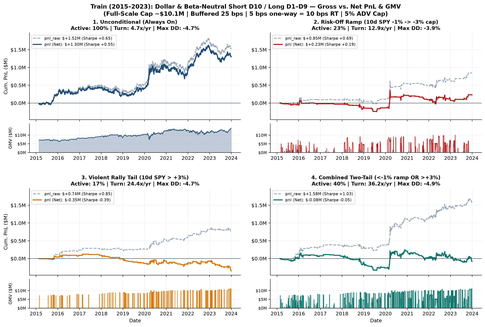

# Research Memo: Point-in-Time SEC 13F Institutional Positioning Factors

**Date:** November 22, 2026  
**Repository:** `sec13f-positioning` (`python -m src.run_pipeline --stage all`)  
**Supporting Materials:** Pre-executed notebook ([`notebooks/factor_research.ipynb`](../notebooks/factor_research.ipynb)), engineering audit log ([`docs/research_log.md`](../docs/research_log.md)), entity governance ([`docs/data_governance.md`](../docs/data_governance.md)), 65 unit & adversarial PIT tests (`tests/`).

---

## 1. Executive Summary & Factor Hypothesis

SEC Form 13F filings disclose US institutional long equity holdings with a statutory **45-day reporting lag** (plus occasional late or amended filings). Any defensible 13F signal must explain **why predictive information survives a 45-to-135-day publication delay**. Across our institutional universe, we tested four distinct positioning hypotheses spanning *structural positioning state*, *quarterly trade flow*, and *manager selection*:

- **Validated Signal — 2-Pillar Institutional Crowding (`crowding_z`):**
  - *Hypothesis & Mechanism:* Measures both how much of a stock's float our institutional universe owns (`pct_own`) and how many days of market volume are required to exit (`days_to_exit`), equally weighted after size neutralization. When peers share crowded positions through a narrow liquidity exit, macro drawdowns or factor rotations force synchronized de-grossing and asymmetric underperformance.
  - *Why it survives the 45-day lag:* Institutional positions unwind slowly—stock-level crowding rankings barely change from one quarter to the next (**1-quarter rank correlation = `+0.95`**)—so exit congestion reported on Day +45 still accurately describes the live shareholder base.
  - *Decile & Portfolio Convention:* Stocks are sorted daily into **10 equal-count crowding deciles** from **Decile 1 (`D1`, least crowded)** to **Decile 10 (`D10`, most crowded)**. **`> D7` (`D8–D10`)** denotes the top 30% most crowded names. Because crowding drag concentrates sharply in the right tail, we also test **`D10 − D1–D9`** (shorting the most crowded 10% against a diversified long basket of the remaining 90%) to monetize the crowded-tail liquidation spread while neutralizing broad market and mid-cap vs. `SPY` basis risk.
- **Three Alternatives Tested & Rejected In-Sample (Hypothesis First, Then Empirical Verdict):**
  - *Concentration Shifts (`delta_pct_own`):* **Hypothesis:** Quarter-over-quarter active increases in institutional ownership should signal fresh fundamental conviction and buying pressure. **Result:** Fails In-Sample (`p = 0.817`); trade flows executed 45–135 days earlier do not persist quarter-to-quarter (**1Q corr = `+0.17`**) and are already priced in by Day +46.
  - *Naive Smart Money (Report-Date Dollars):* **Hypothesis:** Stocks attracting the largest aggregate institutional dollars (valued strictly at each filing's report date) should reflect high-conviction consensus ideas worth following. **Result:** Fails In-Sample (`p = 0.442`); raw dollars are mega-cap confounded (`corr(size) = +0.57`), and size-neutralized log dollars reduce to a noisier proxy for `pct_own` (`corr = +0.70`).
  - *Manager-Skill Smart Money (8-Quarter Static `IR_badj`):* **Hypothesis:** Weighting live holdings by each manager's trailing 8-quarter beta-adjusted Information Ratio—frozen strictly on completed prior quarters to strip out market beta and intra-quarter stock momentum—should isolate skilled stock-pickers from asset-gatherers. **Result:** Fails In-Sample (`p = 0.951`); 1-quarter manager persistence is near zero (`Rank IC = +0.034`) and trailing 2-year rankings suffered Growth-vs-Value whipsaw across 2020–2023.

**Headline Results — Strictly In-Sample (`2015–2023`) vs. Untouched Frozen Out-of-Sample (`2024–2026`):**
- **Pure Signal Stability:** `crowding_z` validated In-Sample (**`-0.535 bps/d, z = -2.38, p = 0.0175`**; tail spread `D10 − D1–D9 = -1.744 bps/d, p = 0.0061`) and held an almost identical slope in the 726-day Frozen OOS window (**`-0.556 bps/d`**, `p = 0.232`).
- **Short Top 30% Crowded (`> D7`) vs. `SPY` Beta Hedge (Buffered):** Train Net Sharpe **`+0.49`** (Ann Ret `+3.99%`, Ann SDev `8.19%`, Max DD `-23.1%`); Frozen OOS Net Sharpe **`+0.68`** (Ann Ret **`+6.20%`**, Ann SDev **`9.13%`**, Max DD **`-10.5%`**)—decomposing into `~3.8%/yr` genuine crowding alpha plus `~2.4%/yr` `SPY` mega-cap vs. mid-cap basis tailwind.
- **Dollar-Neutral Short `D10` / Long `D1–D9` (Buffered):** Outperformed In-Sample (Net Sharpe **`+0.55`**, Ann Ret `+1.46%`, Ann SDev `2.63%`, Max DD cut 5× to **`-4.7%`**), but stalled flat OOS (Net Sharpe **`-0.04`**, Ann Ret `-0.13%`, Ann SDev `3.27%`, Max DD `-5.0%`) as closed 2015-era funds reduced `D10` physical crowding 34% (`18.7 → 12.4d`) and OOS drag broadened into `D8–D9`.

---

## 2. Scope Decisions & Deliberate Exclusions

*"Trying to do everything is a failure mode."* Every scope boundary was chosen to assemble a **diverse, representative cohort of concentrated fundamental institutional investors**—suitable for cleanly testing crowding, concentration shifts, and smart-money skill—with strict PIT integrity and a ~15–20 minute clean-clone runtime:

| Dimension | Chosen Scope | Alternatives Considered & Why Excluded |
|---|---|---|
| **Institutional Universe** (`config/filers.yaml`) | • **100 audited fundamental equity institutions** across Growth/TMT, Value, and Quality styles (`84` active + `16` closed 2015-era anti-survivorship peers; **`$850.1B`** median book). • Filtered from `13,075` EDGAR filers via continuity (`>= 8Q`), scale (`>= $2B`), and concentration (`10–100` holdings). | • *Passive indexers (Vanguard/BlackRock):* Dilute active positioning signals with passive index weights. • *Quant, market-makers & pod shops (Citadel/RenTech/Millennium):* Fast turnover and internal netting render 45-day snapshots stale. • *Pure 13D activists & Berkshire Hathaway:* 10-day Schedule 13Ds front-run Day 45; Berkshire distorts dollar metrics. • *Unfiltered 265-filer raw screen:* Admits duplicate sub-CIKs (`Fundsmith Services`) and PE/VC/endowment noise. |
| **Equity Universe** (`src/pit/panel.py`) | • **Seasoned (`>= 252` trading days) US Common Stocks only** (avg **`731.5`** stocks/day). • Dynamic PIT liquidity/size floors anchored pre-IS (`2014-12-31`) at **`$1.0B` MCap / `$5.0M` 20d ADV**, scaled forward by `SPY`'s trailing 60-day SMA ending `t-1`. | • *Options (`PUT`/`CALL`), ADRs, REITs, ETFs, SPAC units & IPOs:* Different market microstructure, fee/dividend mechanics, or missing 1-year beta history. • *Fixed benchmark index membership:* Introduces historical constituent lookahead and removes mid-cap crowding dispersion. • *Static nominal floors (e.g., fixed `$2B/$10M`):* Causes severe universe drift across 3.4× market appreciation from 2015–2026. |
| **Time Window & Split** (`config/settings.yaml`) | • **Train (IS):** `2015-01-01 → 2023-12-31` (`9` yrs, `2,232` signal days; `2014` market burn-in). • **Frozen OOS:** `2024-01-01 → 2026-11-20` (`2.9` yrs, `726` days). • Guarded strictly on realized `fwd_ret_date <= 2023-12-31`. | • *Shorter `< 1`-year OOS holdout:* Virtually zero statistical power on a quarterly signal (Sharpe SE `> 1.0`); ~3 years halves SE (`~0.59`) and tests modern AI/concentration markets. • *Pre-2015 history:* Pre-XML EDGAR text parsing adds heavy engineering noise for older market regimes. |
| **Hedging & Cost Model** (`src/backtest/engine.py`) | • **Beta neutrality:** Hedged daily against `SPY` using lagged 252-day stock beta (plus a dollar-neutral long/short portfolio test). • **Execution & carry:** `5 bps`/side (`10 bps` RT) on drifted trades, `1 bp` on `SPY` hedges, and explicit short-borrow sensitivity (`0–250 bps/yr`). | • *Full multi-factor risk model (FF5 + Momentum + GICS sectors):* Deferred to keep the core pipeline transparent and self-contained; `SPY` vs. mid-cap basis is diagnosed explicitly in OOS attribution. • *Live prime-broker stock-loan locates:* Requires paid vendor data (Markit/EquiLend); modeled via breakeven borrow and prioritized #1 in Section 5. |

---

## 3. Data Engineering, Point-in-Time Discipline & Methodology

### 3.1 Ingestion Hygiene & Strict Point-in-Time Guards (65 Automated QA Tests)
- **Filer Deduplication & CIK Stitching (`src/ingest/entity_audit.py --strict`):**
  - Audited `308,891` EDGAR `master.idx` filings (`2015 Q1 → 2026 Q4`) against declarative `config/filers.yaml`; yielded **`4,469` deduplicated filings** (`4,219` `13F-HR`, `250` `13F-HR/A`), **`0`** duplicate quarters, and **`0`** cross-filer `<otherManagers>` overlaps.
  - Stitched **5 legal-entity CIK migrations** via date-bounded `predecessor_ciks` (`Greenlight → DME`, `Ruane Cunniff`, `TCI`, `Hillhouse → HHLR`, `Appaloosa`), excluded overlapping affiliate `13F-HR`s (`Steadfast UK`, `Fundsmith Services`, `Sands Ventures`), and retained 16 closed peers with `status: closed` strictly non-operational.
- **Complete-Submission XML Parsing & Multi-Mode Unit Normalization (`src/ingest/filings.py`):**
  - Parsed raw SGML `.txt` submissions (preserving exact `<ACCEPTANCE-DATETIME>` and live `2026 Q4` tail, with HTTP `502` directory fallback).
  - Strictly PIT auto-corrected **`114` filings** across three SEC `<value>` unit-error modes—`$1,000s` post-2023 (`Baupost`), exact `$1` pre-2023 (`Lone Pine`), and `$1,000,000s` pre-2023 (`Luxor`, `Trilogy`, `Harding Loevner`)—via within-filing `median(value / shares)` checks (**`0`** suspect filings left).
- **CUSIP/CINS Mapping & Dual-Class Rollup (`src/ingest/cusip_mapper.py`):**
  - Mapped **`99.39%`** of tracked 13F dollars via OpenFIGI (`ID_CUSIP` + `ID_CINS` + `shareClassFIGI` stitching + 13 overrides in `config/cusip_overrides.yaml`) into `3,861` persistent US Common Stock `security_id`s (`194` CUSIP stitches, e.g., `Priceline → BKNG`, `UTX → RTX`).
  - Rolled up equal-ratio dual-class issuers (`GOOGL/GOOG`, `FOXA/FOX`, `NWSA/NWS`) by `issuer_cik`, keeping only the highest-ADV primary class.
- **Immutable PIT Ledger for `13F-HR/A` & Confidential Treatment Requests (CTRs) (`src/pit/ledger.py`):**
  - Versioned each `(filer_id, period_of_report)` over `(valid_from, valid_to)` with `effective_date = next_trading_day(max(date_filed, acceptance_date))` on the `SPY` calendar, guaranteeing **`filing_date < query_date`** on every row.
  - `RESTATEMENT` replaces its exact quarter without reverting newer books; `NEW HOLDINGS` upserts by CUSIP (preventing share doubling while surfacing **`99` CTR reveals**); `zero_holdings` clears immediately and `max_staleness_days = 160` retires ceased filers PIT. Verified **`249/249`** amended `T` vs. `T+1` boundaries.
- **Forward-Only Split Alignment & Production QA Scrubbers (`src/pit/panel.py`, `src/pit/compute.py`):**
  - Empirically verified 13F shares report on **`period_of_report` (pre-split)** basis (`152/156` straddling rows) while GAAP ASC 260 XBRL shares report on **`filed_date` (post-split)** basis (`100%`). Forward-adjusting via $k = F_{\text{fut}}(\text{from})/F_{\text{fut}}(t)$ cancels all post-$t$ splits identically (preventing `8.37×` `NVDA` and `4.22×` `GOOGL` straddle errors and preserving exact `pct_shares_owned` continuity across split ex-dates).
  - Scrubbed `60` future-dated XBRL typos (`end_date > filed_date`), **`1,571` XBRL unit-scale outliers (`0.49%`)** strictly PIT at `<= filed_date`, and `80` Yahoo bankruptcy/reorg splices (`ret > +500%` or `<= -99%`, e.g., `CHRD +25,733%`) inside lagged 252-day masked OLS beta (`[t-252, t-1]`, removing **`98.4%`** of universe `SPY` beta). Vectorized panel (`3.86M` rows) verified to **`max_rel_err <= 6.54e-13`** across 6 stress dates.

### 3.2 Factor Construction & Rack-Based Backtester Architecture
- **Phase 3 — Pure Econometric Signal Validation (Decoupled from Portfolio Rules):**
  - Cross-sectional 1%/99%-winsorized z-scores orthogonalized daily against `log(pit_mcap_usd)`; evaluated via date-clustered panel OLS (`fwd_beta_adj_ret_bps ~ const + z_sn`, clustered by `query_date`).
  - *Why equal-weight 2-pillar crowding beats multilinear OLS:* `pct_own_sn` (`-0.558 bps/d, p=0.067`) and `days_to_exit_sn` (`-0.441 bps/d, p=0.030`) measure one congestion mechanism (`corr = +0.761, VIF = 2.37`). Unconstrained multilinear OLS inflates SEs `2.3–2.9×`; equal-weight `crowding_z` estimates zero free weights and lifts precision to **`-0.535 bps/d` (`z = -2.38, p = 0.0175`)**.
- **Phase 4 — Rack-Based `T+1` MOC Backtester (`src/backtest/engine.py`):**
  - *Sizing & Liquidity:* Accepts any `(date × security_id)` expected-return rack and sizes $N^*_{i,t} = \text{clip}(\$50{,}000 \times \hat{r}_{i,t},\ \pm 5\%\ \text{ADV}_{20d})$ using frozen IS slope (`-0.5348 bps/d`).
  - *Drift, Costs & Frequency:* Prior notionals drift daily via corporate-action-clean `prev_day_ret`; trades pay **`5 bps`/side (`10 bps` RT)** on $|N_{i,t} - N^{\text{drift}}_{i,t}|$ + `1 bp` on net `SPY` hedges ($H_t = -\sum_i N_{i,t}\beta_{i,t}$). Benchmarked **Daily**, **Buffered Event-Driven (`25 bps` GMV band)**, and **Fixed Quarterly (`Day +46`)**.

---

## 4. Empirical Results: Signal vs. Noise & Out-of-Sample Assessment

### 4.1 Phase 3 — Four-Signal In-Sample Validation Matrix (`2015–2023`, Zero OOS)

| Candidate Signal (Size-Neutral) | `1Q Corr` | Slope (`bps/d`) | SE | `z`-stat | `p`-val | `R²` (Panel) | Tail Spread (`p`) | Decision |
|---|---:|---:|---:|---:|---:|---:|---:|---|
| **1. Crowding (`crowding_z`, 2-Pillar)** | **`+0.947`** | **`-0.535`** | **`0.225`** | **`-2.38`** | **`0.0175`** | **`6.71e-06`** | **`D10−Rest: -1.74` (`0.0061`)** | **VALIDATED** |
| **2. Concentration Shifts (`delta_pct_own`)** | `+0.165` | `-0.055` | `0.237` | `-0.23` | `0.8166` | `6.99e-08` | `D10−Rest: -0.23` (`0.477`) | **REJECTED** *(stale flow)* |
| **3a. Smart Money (`log_dollars_rpt_sn`)** | `+0.880` | `-0.246` | `0.320` | `-0.77` | `0.4416` | `1.42e-06` | `D10−Rest: -1.08` (`0.130`) | **REJECTED** *(Crowding proxy)* |
| **3b. Manager Skill (`skill_conv_sn`, 8Q IR)** | — | `-0.044` | `0.722` | `-0.06` | `0.9509` | `4.38e-08` | `D10−D1: -0.44` (`0.846`) | **REJECTED** *(weak IC)* |

- **Interpreting Panel `R²`:** Daily single-stock idiosyncratic vol (~250 bps/d) means even statistically significant daily equity factors have tiny single-stock `R² ~ 10^-6`; `crowding_z` (`6.71e-06`) is ~100× stronger than rejected flow/skill signals (`4–7e-08`).
- **Alternative Specifications Equally Flat:** Constant-price `Δw` (`p=0.365`), `ΔHHI` (`p=0.314`), net buyer ratio (`p=0.375`), raw VIP dollars (`+0.004 bps/d, p=0.990`), and style-relative 4Q/8Q/12Q manager skill (`+0.12 to +0.54 bps/d, p=0.16–0.77`).

- **Tail Nonlinearity & 10-BD `SPY` Risk-Off Mechanism (Strictly PIT, IS `2015–2023`):**
  - *Decile Cliff:* Crowding drag starts above `D7` and peaks sharply in **`D10`** (`11.8%` owned, `18.7 days_to_exit`, `-2.09 bps/d`; `D10 − D1–D9 = -1.74 bps/d, t = -2.74`).
  - *Risk-Off De-Risking (`10-BD SPY < 0%`, `790d`):* Losses concentrate specifically in **`D9` (`-3.75 bps/d`)** and **`D10` (`-5.52 bps/d`; `D10 − Rest = -3.23 bps/d, t = -2.74`)**, deepening to **`-8.33 bps/d`** (`D10 − Rest = -6.00 bps/d, t = -2.11`) in `<= -3%` stress with **zero buy-the-dip bounce**.
  - *Calm vs. Violent Rallies:* Calm `-1%..+3%` markets (60% of days) are flat (`-0.07 / -0.20 bps/d`), while violent `> +3%` rallies (`380d`) trigger rotation drag (`D10 − Rest = -4.91 bps/d, t = -3.12`).

---

### 4.2 Phase 4 Train (`2015–2023`): Rebalancing Horizons & Gross-vs-Net Turnover Reality

- **Rebalancing Horizon Winner — Buffered Event-Driven (`25 bps` Band):**
  - *vs. Daily Rebalance:* Cuts turnover **60%** (`9.21× → 3.71×`; `74.5%` of Daily trades chased noisy 20d ADV wiggles) and lifts Net Sharpe (`0.45 → 0.49`, `+$2.43M` net, BE Borrow `399 bps/yr`).
  - *vs. Fixed Quarterly (`Day +46`):* Captures `+$404k` of timely `T+1` filing-wave alpha missed by quarterly rebalances (`+$2.03M, Sharpe 0.42`), staying solidly positive even at `20 bps`/side (`40 bps` RT: `+$2.09M, Sharpe 0.42`).
- **Dollar-Neutral `Short D10 / Long D1–D9` & Gross-vs-Net Turnover Reality:**
  - *Unconditional Dollar-Neutral Benefit:* Lifted Train Net Sharpe to **`+0.55`**, tightened `SPY β` to `-0.009`, and slashed Max DD nearly **5×** (`-23.1% → -4.7%`) by removing `SPY` vs. mid-cap basis noise.
  - *Why Fast Regime Timing Failed Net of Costs:* Combined Two-Tail gating achieved a headline **`+1.03` Gross Sharpe** (`+$1.58M` in `40%` of days), but repeatedly crossing a ~700-stock book exploded turnover to **`36.2×/yr` (`$1.66M` slippage)**, collapsing Net Sharpe to **`-0.05`**.
  - *Locked OOS Candidates:* Proceeded strictly with **Buffered `Short > D7 vs. SPY`** and **Unconditional Buffered `Short D10 / Long D1–D9`** (zero regime-timing parameters to overfit OOS).

---

### 4.3 Single Frozen Out-of-Sample Evaluation (`2024-01-02 → 2026-11-20`, `726` Days)

Evaluated both locked strategies once on untouched `2024–2026` data with frozen IS parameters (slope `-0.5348 bps/d`, `$50k/bps`, `5% ADV` cap, `25 bps` buffer, `5 bps`/side + `1 bp` `SPY` hedge; zero refitting):

| Frozen Strategy (`Buffered 25 bps`) | Split | Days | Avg GMV | `pnl_raw` | `pnl` (Net) | Ann Ret | Ann Vol | Sharpe (Raw/Net) | Max DD | Turn (`/yr`) | `SPY β` | BE Borrow |
|---|---|---:|---:|---:|---:|---:|---:|---:|---:|---:|---:|---:|
| **Short `> D7` vs. `SPY`** | Train (`2015–23`) | 2,232 | `$6.89M` | `+$2.57M` | `+$2.43M` | `+3.99%` | `8.19%` | `+0.51 / +0.49` | `-23.1%` | `3.71×` | `-0.031` | `399 bps` |
| **Short `> D7` vs. `SPY`** | **OOS (`2024–26`)** | **726** | **`$7.75M`** | **`+$1.45M`** | **`+$1.39M`** | **`+6.20%`** | **`9.13%`** | **`+0.71 / +0.68`** | **`-10.5%`** | `4.40×` | `+0.066` | **`620 bps`** |
| **Short `> D7` vs. `SPY`** | Full (`2015–26`) | 2,958 | `$7.11M` | `+$4.06M` | `+$3.87M` | `+4.64%` | `8.49%` | `+0.57 / +0.55` | `-22.3%` | `3.90×` | `-0.010` | `464 bps` |
| Short `D10` / Long `D1–D9` | Train (`2015–23`) | 2,232 | `$10.07M` | `+$1.52M` | `+$1.30M` | `+1.46%` | `2.63%` | `+0.65 / +0.55` | `-4.7%` | `4.69×` | `-0.009` | `341 bps` |
| Short `D10` / Long `D1–D9` | **OOS (`2024–26`)** | **726** | `$11.32M` | `+$48.5k` | **`-$42.2k`** | `-0.13%` | `3.27%` | **`+0.05 / -0.04`** | `-5.0%` | `4.95×` | `+0.023` | `-29 bps` |
| Short `D10` / Long `D1–D9` | Full (`2015–26`) | 2,958 | `$10.81M` | `+$1.74M` | `+$1.43M` | `+1.13%` | `2.70%` | `+0.51 / +0.42` | `-5.0%` | `4.59×` | `-0.003` | `269 bps` |

### 4.4 Honest Assessment: Signal vs. Noise, Attribution & Low-Confidence Caveats
- **What Worked (Persistent Structural Signal):**
  - Pure `crowding_z` slope held steady OOS (**`-0.556 bps/d`** vs. IS `-0.535`); `Short > D7 vs. SPY` earned `+$1.39M` net (`Sharpe +0.68`; still `+0.41` at heavy `250 bps/yr` HTB borrow).
  - *Honest OOS Attribution:* Splits `+6.20%/yr` into **`~3.8%/yr` genuine crowding alpha** (`D8–D10 -2.58` vs. `D1–D7 -1.07 bps/d`) + **`~2.4%/yr` `SPY` mega-cap vs. mid-cap basis tailwind** during the 2024–2026 AI rally.
- **What Didn't Work OOS (`Short D10 / Long D1–D9`, `-$42k`, Sharpe `-0.04`):**
  - *Roster Aging (`-34%` crowding decay):* Fixed 2015-anchored cohort lost retired funds without replacement, reducing `D10` congestion from `18.7 → 12.4 days_to_exit` (`11.8% → 8.4%` owned).
  - *Broadened OOS Drag:* Underperformance peaked in `D8` (`-2.82 bps/d`) and `D9` (`-3.22 bps/d`), which `Long D1–D9` was inadvertently *long*.
- **Low-Confidence Areas & Residual Gaps:**
  - *Borrow & Squeeze Risk:* Crowded `D8–D10` shorts overlap HTB specials and squeezes (`2021 Q1 -23%` DD on `> D7`); true net Sharpe requires stock-loan history.
  - *OOS Power & Free-Data Limits:* 2.9-yr OOS implies `SE(SR) ≈ 0.59`; Yahoo drops `5.12%` of US Common Stock 13F dollars in acquired/delisted names (`ATVI`, `TWTR`, `SPLK`, `PXD`, `WBA`), and flat SEC JSON omits dimensional multi-class shares (`V`, `BRK-B`, `STZ`).

---

## 5. Top Three Next Steps (Priority Order)

1. **Prime-Broker Stock-Loan Borrow, Utilization & FINRA Short Interest (Markit / EquiLend / S3):**
   - *Why #1:* Largest live-deployability bottleneck. Penalizing PIT borrow fees directly in the sizing rack ($\hat{r}_{i,t} - \text{fee}_{i,t}$) and intersecting 13F long crowding with short interest separates *fragile long-only consensus* (clean short) from *crowded short-squeeze traps* (avoid).
2. **Dynamic PIT Manager Roster Replenishment (Form ADV) + CRSP Delisted Returns & Inline-XBRL Shares:**
   - *Why #2:* Directly fixes the 34% OOS `D10` roster-aging decay and 5.12% Yahoo delisting gap via quarterly PIT Form ADV fund replenishment (with automated affiliate-CIK dedup), CRSP delisting-adjusted returns, and full multi-class share counts.
3. **Nonlinear Market-Impact & Execution Capacity Modeling (Square-Root Cost Model):**
   - *Why #3:* Replacing our flat `5 bps`/side cost assumption with a square-root market-impact model (`half_spread + Y·σ·√(order_size / ADV)`) tests both sides of deployability: whether higher-turnover regime-gated books (e.g., Combined Two-Tail's `+1.03` Gross Sharpe) are viable at realistic pod sizes where small trades pay less than `5 bps`, and where illiquid `D10` shorts cap institutional AUM capacity.
