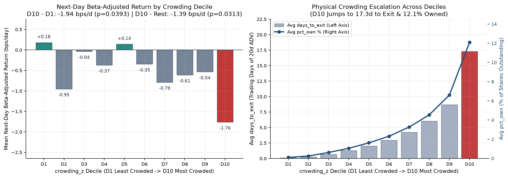
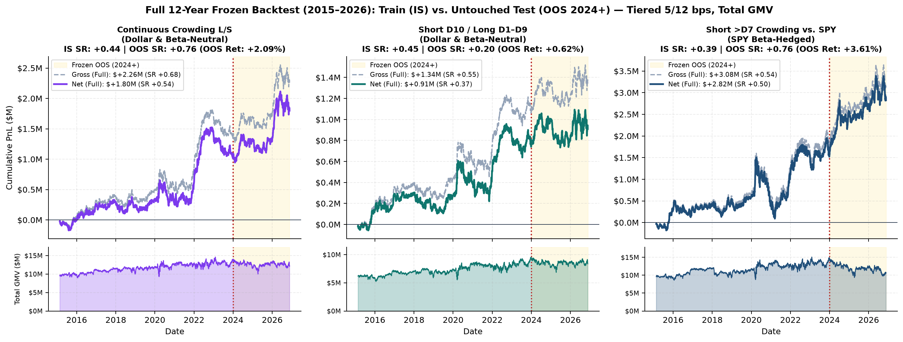

# Research Memo: Point-in-Time SEC 13F Institutional Positioning Factors

**Date:** November 22, 2026  
**Sample:** In-Sample `2015–2023` | Frozen OOS `2024–Nov 2026` (`end_date: "2026-11-20"`)  
**CLI:** `python -m src.run_pipeline --stage all`  
**Companion Artifacts:** Pre-executed notebook ([`notebooks/factor_research.ipynb`](../notebooks/factor_research.ipynb)), engineering audit log ([`docs/research_log.md`](../docs/research_log.md)), entity & CTR governance ([`docs/data_governance.md`](../docs/data_governance.md)), 73 automated QA & adversarial PIT tests (`tests/`).

---

## 1. Factor Hypothesis & Summary of Findings

SEC Form 13F filings disclose US institutional long equity holdings with a statutory **45-day** lag (and later via amendments). Because trades are **45–135 days** old by publication, a defensible 13F signal must explain why predictive power survives the delay. Across our **100-manager** institutional universe and domestic listed US equity panel, we tested four hypotheses spanning structural crowding, quarterly flow shifts, and two forms of smart-money following.

- **Validated Signal — Two-Pillar Crowding (`crowding_z`):**
  - Equal-weight composite of two size-neutralized exit-congestion metrics: share of float held by our institutional universe (`pct_own`) and days of 20-day average volume needed to liquidate (`days_to_exit`).
  - *Why it survives the 45-day lag:* Institutional positions unwind slowly. Stock-level crowding rankings barely move over a quarter (1-quarter rank correlation **`+0.95`**), so congestion disclosed on Day +45 still describes the live shareholder base. During macro stress or rotations, synchronized de-grossing through narrow liquidity exits drives asymmetric selling pressure.
  - *Portfolio expressions:* Eligible stocks are sorted daily into ten equal-count deciles from Decile 1 (`D1`, least crowded) to Decile 10 (`D10`, most crowded). We evaluate three locked expressions on an apples-to-apples **Total Portfolio GMV** basis (stocks + `|SPY hedge|`) under tiered **`5 / 12 bps`** one-way costs (`>= $10B` / `< $10B` PIT MCap): (1) **Continuous Crowding L/S** (dollar- & beta-neutral `-crowding_z`), (2) **Short `D10` / Long `D1–D9`** (tail dollar- & beta-neutral), and (3) **Short `>D7` (`D8–D10`) vs. `SPY`**.
- **Three Alternatives Tested & Rejected In-Sample:**
  - *Concentration Shifts (`delta_pct_own`):* **Hypothesis:** quarter-over-quarter active ownership increases should signal fresh fundamental conviction. **Result:** flat (**`p = 0.882`** ex-CTR reveals; **`p = 0.864`** raw); quarterly flows barely persist (1Q corr **`+0.17`**) and are already priced in by Day +46.
  - *Naive Smart Money (Report-Date Dollars):* **Hypothesis:** stocks holding the largest aggregate institutional dollars (valued strictly at each filing's report date) should capture high-conviction consensus ideas. **Result:** flat (**`p = 0.432`**); raw dollars are size-confounded (**`corr = +0.57`**) and size-neutral log dollars reduce to a noisier proxy for `pct_own` (**`corr = +0.70`**).
  - *Manager-Skill Smart Money (8-Quarter Static `IR_badj`):* **Hypothesis:** weighting live positions by each manager's trailing 8-quarter beta-adjusted Information Ratio—frozen on completed prior quarters to strip out market beta and intra-quarter momentum—should separate skilled stock-pickers from asset-gatherers. **Result:** flat (**`p = 0.982`**); 1-quarter manager persistence is near zero (**`Rank IC = +0.031`**) and 2-year rankings suffered Growth-vs-Value whipsaw across 2020–2023.

| Headline Summary (Buffered `±20%/±2%`, Tiered `5/12 bps`, Total GMV) | Train (IS 2015–2023) | Frozen OOS (2024–2026) | Key Economic Takeaway |
|---|---:|---:|---|
| **Pure `crowding_z` Factor Slope (OLS)** | **`-0.458 bps/d` (`p=0.0452`)** | **`-0.746 bps/d` (`p=0.125`)** | Tail `D10−Rest`: `-1.39 bps/d` (`p=0.0313`) IS; stronger slope OOS |
| **Continuous Crowding L/S (Dollar-Neutral)** | SR **`+0.44`** \| Ret `+0.98%` \| DD `-4.4%` | SR **`+0.76`** \| Ret `+2.09%` \| DD `-3.2%` | Best all-weather book: Full SR **`+0.54`**, `BE borrow 436 bps` OOS |
| Short `D10` / Long `D1–D9` (Dollar-Neutral) | SR **`+0.45`** \| Ret `+1.15%` \| DD `-5.3%` | SR **`+0.20`** \| Ret `+0.62%` \| DD `-3.8%` | Tight `-3.8%` OOS DD; muted OOS as drag broadened into `D8–D9` |
| Short `>D7` Crowding vs. `SPY` | SR **`+0.39`** \| Ret `+1.50%` \| DD `-12.1%` | SR **`+0.76`** \| Ret `+3.61%` \| DD `-5.6%` | Captures `D8–D10` alpha + `SPY`/mid-cap basis on Total GMV |

---

## 2. Scope Decisions & Deliberate Exclusions

We bounded scope to assemble a diverse, representative cohort of concentrated fundamental institutional investors—suitable for testing crowding, flow shifts, and manager skill cleanly—with strict point-in-time hygiene and a reproducible ~**15–20 minute** cold-clone runtime (`end_date: "2026-11-20"` pinned in `config/settings.yaml`).

| Dimension | Chosen Scope | Alternatives Considered & Why Excluded |
|---|---|---|
| **Institutional Universe** (`config/filers.yaml`) | • **100** audited fundamental equity institutions across Growth/TMT, Value, and Quality styles (**84** active + **16** closed 2015-era peers; **`$850.1B`** median book). • Screened from **13,075** EDGAR filers via continuity (`>= 8Q`), scale (`>= $2B`), and concentration (`10–100` holdings). | • *Passive indexers (Vanguard, BlackRock):* Dilute active positioning signals with benchmark weights. • *Quant, market-makers & pod shops (Citadel, RenTech, Millennium):* Fast turnover and internal netting make 45-day snapshots stale. • *Pure 13D activists & Berkshire Hathaway:* 10-day 13Ds front-run Day 45; Berkshire distorts dollar aggregates. • *Unfiltered 265-filer raw screen:* Admits duplicate sub-CIKs and PE/VC/endowment noise. |
| **Equity Universe** (`src/pit/panel.py`) | • Seasoned (`>= 252` prior trading days) **listed domestic US Common Stocks** (`10-K`/`10-Q` SEC filers only; avg **683.6** stocks/day; **1,385** tickers). • Dynamic PIT floors anchored pre-IS (`2014-12-31`) at **`$1.0B`** MCap / **`$5.0M`** 20d ADV, scaled forward by SPY's trailing 60-day SMA ending `t-1`. | • *OTC venues (`UD`/`UO`/`PQ`), 5-letter `[FYQ]` foreign/bankrupt tickers, and `20-F`/`40-F` foreign issuers:* US-only Yahoo ADV massively distorts `days_to_exit` on foreign-primary stocks (`RCI`, `CNI`, `BUDFF`). • *Options, ADRs, REITs, ETFs, SPACs & IPOs:* Different microstructure or missing 1-year beta history. • *Fixed index membership / static nominal floors:* Lookahead bias or severe drift across **3.4×** appreciation. |
| **Sample Split** (`config/settings.yaml`) | • Train (IS): `2015-01-01` to `2023-12-31` (**9 yrs**, **2,232** signal days; 2014 burn-in). • Frozen OOS: `2024-01-01` to `2026-11-20` (**2.9 yrs**, **726** days), guarded on realized `fwd_ret_date <= 2023-12-31`. | • *Shorter `< 1`-year OOS holdout:* Almost no statistical power on a quarterly signal (Sharpe SE `> 1.0`); ~3 years halves SE (~**0.59**) and tests modern AI/concentration markets. • *Unpinned `end_date: null`:* Would drift OOS metrics on future cold-clone runs. |
| **Hedging & Costs** (`src/backtest/engine.py`) | • Daily stock-level beta hedge vs. `SPY` (lagged 252d beta) + dollar-neutral L/S books evaluated on **Total Portfolio GMV** (stocks + `|SPY hedge|`). • Tiered **`5 bps`** (`>= $10B` PIT MCap) / **`12 bps`** (`< $10B`) one-way costs (`~9–10 bps` blended) + **`1 bp`** SPY hedge + borrow grid (`0–250 bps/yr`). | • *Flat 5 bps across all market caps:* Understates execution slippage in crowded mid-cap `D8–D10` names (`~60–70%` of traded notional is `< $10B`). • *Multi-factor risk model & prime-broker locates:* Deferred to Section 5 to keep the pipeline fully self-contained on public data. |

---

## 3. Data Engineering, Point-in-Time Discipline & Methodology

### 3.1 Ingestion Hygiene & Point-in-Time Guardrails (73 Automated QA Tests)

Most errors in 13F research hide in entity duplication, XML scale/column-swap bugs, foreign-venue ADV distortion, retroactive amendments, and split mismatches. Table 1 summarizes our automated PIT engineering guards; Table 2 verifies split alignment on real historical events.

| Pipeline Stage | Volume & Coverage | PIT Hygiene & Real-World Edge Cases Resolved |
|---|---|---|
| **Filer Dedup & CIK Audit** (`entity_audit.py --strict`) | **308,891** index rows → **4,469** filings (**4,219** HR, **250** HR/A); **0** dup quarters | Stitched **5** date-bounded CIK migrations (Greenlight→DME, Ruane Cunniff, TCI, Hillhouse→HHLR, Appaloosa); excluded overlapping affiliates (Steadfast UK, Fundsmith Services, Sands Ventures); **0** cross-filer `<otherManagers>` overlaps; **16** closed peers retained strictly non-operationally. |
| **XML Parsing, Units & `<sshPrnamt>` Guard** (`filings.py`) | **114** filings unit-corrected; **1** corrupt filing quarantined; **0** suspect remaining | Parsed raw SGML `.txt` submissions (exact `<ACCEPTANCE-DATETIME>`, HTTP 502 directory fallback). Auto-corrected 3 SEC `<value>` unit bugs strictly PIT via median implied price (`Baupost`, `Lone Pine`, `Luxor`/`Trilogy`). Quarantined Harding Loevner's `2015-01-12` column-swapped XML (`$1.84T` implied book, restated 2 days later) before entering the PIT ledger. |
| **CUSIP, OTC & Domestic Gate** (`cusip_mapper.py`, `panel.py`) | **99.39%** of 13F `$` mapped; **3,650** listed US Common IDs (**185** stitches) | Mapped via OpenFIGI (`ID_CUSIP`, `ID_CINS`, `shareClassFIGI` + **13** overrides). Excluded OTC venues (`UD`/`UO`/`PQ`), 5-letter `[FYQ]` tickers, and `20-F`/`40-F` foreign issuers (`is_domestic_sec_filer`). Rolled up equal-ratio dual-class issuers (`GOOGL`/`GOOG`, `FOXA`/`FOX`, `NWSA`/`NWS`) by CIK, keeping the highest-ADV primary class. |
| **PIT Ledger: `13F-HR/A` & CTRs** (`ledger.py`, `concentration.py`) | **249/249** amended `T` vs. `T+1` verified; **99** CTR rows; **72** omitted filings | Versioned `(filer_id, period_of_report)` over `[valid_from, valid_to)` with `effective_date = next_trading_day(max(date_filed, acceptance_date))` (`filing_date < query_date`). Propagated `is_confidential_omitted` (`has_confidential_omitted_filer`, `6.36%` of IS obs, documenting incomplete base-filing weights) and masked `has_ctr_reveal` (`1,703` IS obs) out of `delta_pct_own` flow spikes. |
| **Splits, XBRL & Beta QA** (`panel.py`, `compute.py`) | **3.71M** panel rows; parity **`<= 6.54e-13`**; **98.4%** SPY β removed | Forward-adjusted 13F shares from `period_of_report` and GAAP ASC 260 XBRL shares from `filed_date` via `k = F_fut(from)/F_fut(t)`. Scrubbed **60** future XBRL dates and **3,055** XBRL scale/sequential-QoQ outliers (**0.95%**, catching `ZTS` 20×, `HPQ`/`NTAP` 10×, `CLX` 131B strictly PIT without touching splits) plus **80** Yahoo reorg splices (`CHRD`) in lagged 252d masked beta. |

| Real Split Ex-Date / Straddle Verification | Event | Filers | Naive Sum / Raw Close | PIT Split-Aligned Value | Integrity Proof |
|---|---|---:|---:|---:|---:|
| `2024-08-12` NVDA (Cross-Filer Straddle) | 10:1 Split | 22 | `35.25M sh` (mixed) | **`295.10M sh`** | **`8.37×`** error prevented |
| `2022-11-10` GOOGL (Cross-Filer Straddle) | 20:1 Split | 39 | `28.55M sh` (mixed) | **`120.61M sh`** | **`4.22×`** error prevented |
| `2020-08-28 → 08-31` AAPL (Ex-Date Continuity) | 4:1 Split | 16 | `$499.23 → $129.04` | `pct_own`: **`0.3299% → 0.3299%`** | MCap ret `+3.39% == true` |
| `2024-06-07 → 06-10` NVDA (Ex-Date Continuity) | 10:1 Split | 23 | `$1,208.88 → $121.79` | `pct_own`: **`1.2036% → 1.2036%`** | MCap ret `+0.75% == true` |

### 3.2 Factor Construction & Rack-Based Backtester
- **Phase 3 — Pure Econometric Validation:** Daily 1%/99%-winsorized z-scores orthogonalized against `log(pit_mcap_usd)`, evaluated via date-clustered panel OLS (`fwd_beta_adj_ret_bps ~ const + z_sn`). Because `pct_own_sn` (**`-0.513 bps/d`**, `p=0.090`) and `days_to_exit_sn` (**`-0.357 bps/d`**, `p=0.088`) share **`corr = +0.815`** (**`VIF = 2.98`**), unconstrained multilinear OLS inflates SEs **2.7–3.5×**; equal-weight `crowding_z` estimates zero free weights and lifts precision to **`-0.458 bps/d`** (**`z = -2.00, p = 0.0452`**).
- **Phase 4 — Rack-Based T+1 MOC Backtester (`src/backtest/engine.py`):** Sizes any `(date × security_id)` expected-return rack at `N* = clip($50k × r_hat, ±5% ADV_20d)` using the frozen IS slope (**`-0.4580 bps/d`**) and strictly day-`t` observable tradability (`has_market_price & isfinite(beta_lag1)`, zero `t+1` return peeking). Held notionals drift daily via corporate-action-clean `prev_day_ret`; trades pay tiered **`5 / 12 bps`** one-way costs (`>= $10B` / `< $10B` PIT MCap, `~9.1–10.0 bps` blended) + **`1 bp`** on net SPY hedges (`H_t = −Σ N_i β_i`). Benchmarked Daily, Buffered (**±20%** per-position trade-to-boundary band + **±2%** GMV net-dollar guard), and Fixed Quarterly (Day +46), reporting standard **one-way turnover** (`0.5 × two-way traded / Total GMV`) on **Total Portfolio GMV** (stocks + `|SPY hedge|`).
- **MOC Execution Timing Discipline:** All filing inputs (`13F-HR`, `13F-HR/A`, XBRL shares) and rolling `SPY` betas enforce strict `T+1` lags (`filed < t`, beta over `[t-252, t-1]`) because EDGAR submissions arrive intraday/after-hours. Live market inputs (`raw_close`, `adv_20d`, `spy_ret_10d`) use day-`t` session prices to form day-`t` MOC orders earning `(t → t+1]` — actionable via ~15:45 ET live snapshots ahead of 15:50/15:55 ET exchange MOC cutoffs (and all three locked OOS books are strictly unconditional with zero `SPY` regime triggers).

---

## 4. Empirical Results: Signal, Noise & Out-of-Sample Evaluation

### 4.1 Phase 3 — Four-Signal In-Sample Validation Matrix (2015–2023, Zero OOS)

| Candidate Signal (Size-Neutral) | 1Q Corr | Slope | SE | z-stat | p-val | R² (Panel) | Tail Spread (p) | Decision |
|---|---:|---:|---:|---:|---:|---:|---:|---|
| **1. Crowding (`crowding_z`, 2-Pillar)** | **`+0.947`** | **`-0.458`** | **`0.229`** | **`-2.00`** | **`0.0452`** | **`4.96e-06`** | **`D10−Rest: -1.39` (`0.0313`)** | **VALIDATED** |
| 2. Concentration Shifts (`delta_pct_own`) | `+0.169` | `-0.035` | `0.237` | `-0.15` | `0.8820` | `2.90e-08` | `D10−Rest: -0.66` (`0.463`) | REJECTED (stale) |
| 3a. Smart Money (`log_dollars_rpt_sn`) | `+0.880` | `-0.255` | `0.324` | `-0.79` | `0.4315` | `1.54e-06` | `D10−Rest: -0.94` (`0.189`) | REJECTED (proxy) |
| 3b. Manager Skill (`skill_conv_sn`, 8Q IR) | — | `+0.016` | `0.707` | `+0.02` | `0.9820` | `6.02e-09` | `D10−D1: -0.32` (`0.889`) | REJECTED (noise) |

*Skepticism on R² vs. Directional Alpha:* A single-stock daily R² of **`4.96e-06`** explains virtually zero single-stock variance (daily idiosyncratic vol σ ≈ **205.6 bps/d**)—warranting genuine skepticism, as crowding cannot forecast individual daily moves and leaves small baskets exposed to single-name spikes. Yet the statistical precision (**`p = 0.0452`**; `D10 − Rest` **`p = 0.0313`**) should not be discredited: for a standardized daily factor, `R² ≈ (slope / σ)² = (0.458 / 205.6)²`, so real directional alpha looks microscopic per stock (~**170×** above `delta_pct_own` at **`2.90e-08`**) and must be harvested across broad, diversified portfolios. Alternative proxies were equally flat (active Δw `p=0.372` / ex-confidential `p=0.490`, ΔHHI `p=0.176`, net buyer ratio `p=0.342`, raw VIP $ `p=0.868`, style-relative 4Q/8Q/12Q skill `p=0.17–0.67`).

*Figure 1.* In-sample (2015–2023, N = 1,492,111 domestic US stock-days) date-clustered OLS of next-day beta-adjusted returns on `crowding_z` (slope **-0.458 bps/d**, `z = -2.00`, `p = 0.0452`, R² = **4.96e-06**). Left: unbucketed stock-days. Right: 40 equal-count conditional means.

*Figure 2.* Nonlinear tail structure across `crowding_z` deciles (IS 2015–2023). Left: next-day beta-adjusted return plunges in `D10` (**-1.76 bps/d**; `D10 − Rest` = **-1.39 bps/d**, `p = 0.0313`). Right: physical congestion jumps in `D10` to **17.3 days to exit** and **12.1%** of float owned.

| 10-BD Trailing SPY Regime (Strictly PIT, IS 2015–2023) | Days | >D7 (bps/d) | Slope | D10 − Rest (t-stat) | Mechanism |
|---|---:|---:|---:|---:|---|
| **Deep Stress (`<= -3.0%`)** | **239** | **`-3.21`** | **`-1.21`** | **`-5.05` (`t = -1.86`)** | Acute forced de-grossing (`D9 -4.23`, `D10 -7.14 bps/d`) |
| All Risk-Off (`< 0.0%`) | 790 | `-3.39` | `-0.88` | `-2.78` (`t = -2.38`) | Cliff hits `D9` (`-3.15`) & `D10` (`-5.12 bps/d`) |
| Calm (`-1% to +1%` / `+1% to +3%`) | 687 / 644 | `+0.84 / +0.38` | `+0.03 / -0.31` | `-0.02 / -0.39` | **60%** of trading days; crowding spread sits essentially flat |
| Violent Rally (`> +3.0%`) | 380 | `-1.02` | `-0.80` | `-3.54` (`t = -2.12`) | Sharp factor rotation out of crowded consensus longs |

*Figure 3.* Strictly PIT 10-business-day trailing SPY conditioning across all 10 crowding deciles (left) and magnitude buckets (right). Forced de-risking concentrates in `D9–D10`, while calm markets (`-1%` to `+3%`) exhibit near-zero crowding spread.

---

### 4.2 Phase 4 Train (2015–2023): Rebalancing Horizons & Turnover Reality

Before evaluating OOS, we benchmarked three rebalancing horizons on `Short >D7 vs. SPY` and four Dollar & Beta-Neutral `Short D10 / Long D1–D9` iterations (**`$7.27M`** fixed full-scale Total GMV capital base so cash days never distort returns; tiered **`5/12 bps`** one-way costs; standard **1-way** portfolio turnover):

| Train Strategy / Horizon (IS 2015–2023, 2,232d, Tiered `5/12 bps`) | Active | Eff Cost | Ann Ret | Ann SDev | Sharpe (R/N) | Max DD | 1W Turn | SPY β |
|---|---:|---:|---:|---:|---:|---:|---:|---:|
| Short `>D7` vs. SPY — Daily Rebalance | 100% | `9.0 bps` | `+1.37%` | `3.92%` | `0.45 / 0.35` | `-12.3%` | `2.61×` | `-0.016` |
| **Short `>D7` vs. SPY — Buffered (`±20%` pos band)** | **100%** | **`9.6 bps`** | **`+1.50%`** | **`3.86%`** | **`0.43 / 0.39`** | **`-12.1%`** | **`1.39×`** | **`-0.014`** |
| Short `>D7` vs. SPY — Fixed Quarterly (Day +46) | 100% | `8.8 bps` | `+1.30%` | `3.77%` | `0.37 / 0.34` | `-12.3%` | `0.81×` | `-0.010` |
| **`D10 / D1–D9` — 1. Unconditional (Buffered `±20%/±2%`)** | **100%** | **`9.2 bps`** | **`+1.15%`** | **`2.56%`** | **`0.64 / 0.45`** | **`-5.3%`** | **`3.16×`** | **`-0.006`** |
| `D10 / D1–D9` — 2. Risk-Off Ramp (`-1% → -3%` cap) | 23% | `8.5 bps` | `-0.49%` | `1.04%` | `0.92 / -0.47` | `-5.4%` | `8.61×` | `+0.001` |
| `D10 / D1–D9` — 3. Violent Rally Tail (`>+3%`) | 17% | `8.5 bps` | `-1.62%` | `1.24%` | `0.61 / -1.30` | `-14.4%` | `14.1×` | `-0.003` |
| `D10 / D1–D9` — 4. Combined Two-Tail (`<-1%` or `>+3%`) | 40% | `8.5 bps` | `-2.00%` | `1.62%` | **`1.06 / -1.23`** | `-17.7%` | **`22.1×`** | `-0.002` |

- **Rebalancing Horizon — Buffered Event-Driven (`±20%` Position Band + `±2%` Net Guard):**
  - *vs. Daily Rebalance:* Cuts 1-way turnover **47%** (**`2.61× → 1.39×`**; stock-book 1W turnover **`4.47× → 1.80×`**) and lifts Net Sharpe (**`0.35 → 0.39`**).
  - *vs. Fixed Quarterly (Day +46):* Captures **`+20 bps/yr`** of timely T+1 filing-wave alpha missed by quarterly rebalances, staying solidly positive even at flat **20 bps**/side (Net Sharpe **0.34**).
- **Dollar & Beta-Neutral Books & Turnover Reality:**
  - *Unconditional dollar-neutral:* Lifted Train Net Sharpe to **`+0.45`** (`D10/Rest`) and **`+0.44`** (`Continuous L/S`), held stock net exposure strictly within **`±2.0%`** (avg **`+0.6%`**), tightened SPY β to **`-0.006` / `-0.001`**, and cut Max DD more than **2×** (**`-12.1% → -4.4% / -5.3%`**).
  - *Gross-vs-net regime timing:* Combined Two-Tail gating achieved a **`+1.06`** Gross Sharpe in **40%** of days, but cycling a ~670-stock book around 10-day triggers drove 1-way turnover to **`22.1×/yr`** (`$2.35M` tiered slippage), collapsing Net Sharpe to **`-1.23`**.
  - *Locked OOS candidates:* Carried forward three unconditional buffered books (`Continuous Crowding L/S`, `Short D10 / Long D1–D9`, and `Short >D7 vs. SPY`) with zero regime-timing parameters to overfit OOS.

*Figure 4.* Train (2015–2023) Dollar & Beta-Neutral `Short D10 / Long D1–D9` gross (dashed) vs. net (solid) cumulative PnL and Total GMV across four regime iterations under tiered 5/12 bps costs. GMV drops to **`$0M`** on inactive days for the conditional books, illustrating the **`22.1×/yr`** 1-way turnover drag.

---

### 4.3 Single Frozen Out-of-Sample Evaluation (2024-01-02 to 2026-11-20, 726 Days)

All three locked unconditional strategies were evaluated once on untouched 2024–2026 data with frozen IS parameters (slope **`-0.4580 bps/d`**, `$50k/bps`, **5%** ADV cap, **±20% / ±2%** buffer, tiered **`5/12 bps`** one-way + **1 bp** SPY hedge; zero refitting):

| Frozen Strategy (Total GMV, Tiered `5/12 bps`) | Split | Days | Avg GMV | Eff Cost | Ann Ret | Ann SDev | Sharpe (R/N) | Max DD | 1W Turn | SPY β | BE Borrow |
|---|---|---:|---:|---:|---:|---:|---:|---:|---:|---:|---:|
| **Continuous Crowding L/S (Dollar-Neutral)** | Train (2015–23) | 2,232 | `$11.62M` | `10.0 bps` | `+0.98%` | `2.22%` | `+0.59 / +0.44` | `-4.4%` | `1.96×` | `-0.001` | `204 bps` |
| **Continuous Crowding L/S (Dollar-Neutral)** | **OOS (2024–26)** | **726** | **`$12.60M`** | **`9.5 bps`** | **`+2.09%`** | **`2.74%`** | **`+0.90 / +0.76`** | **`-3.2%`** | **`2.42×`** | **`+0.013`** | **`436 bps`** |
| **Continuous Crowding L/S (Dollar-Neutral)** | **Full (2015–26)** | **2,958** | **`$11.87M`** | **`9.8 bps`** | **`+1.29%`** | **`2.38%`** | **`+0.68 / +0.54`** | **`-4.9%`** | **`2.09×`** | **`+0.002`** | **`268 bps`** |
| Short `D10` / Long `D1–D9` (Dollar-Neutral) | Train (2015–23) | 2,232 | `$7.27M` | `9.2 bps` | `+1.15%` | `2.56%` | `+0.64 / +0.45` | `-5.3%` | `3.16×` | `-0.006` | `237 bps` |
| Short `D10` / Long `D1–D9` (Dollar-Neutral) | **OOS (2024–26)** | **726** | `$8.51M` | `8.9 bps` | `+0.62%` | `3.05%` | `+0.36 / +0.20` | **`-3.8%`** | `3.17×` | `+0.022` | `131 bps` |
| Short `D10` / Long `D1–D9` (Dollar-Neutral) | Full (2015–26) | 2,958 | `$7.58M` | `9.1 bps` | `+1.02%` | `2.73%` | `+0.55 / +0.37` | `-5.1%` | `3.16×` | `-0.000` | `212 bps` |
| Short `>D7` vs. `SPY` (Beta-Hedged) | Train (2015–23) | 2,232 | `$11.64M` | `9.6 bps` | `+1.50%` | `3.86%` | `+0.43 / +0.39` | `-12.1%` | `1.39×` | `-0.014` | `319 bps` |
| Short `>D7` vs. `SPY` (Beta-Hedged) | **OOS (2024–26)** | **726** | `$11.97M` | `9.4 bps` | **`+3.61%`** | `4.75%` | **`+0.81 / +0.76`** | `-5.6%` | `1.76×` | `+0.030` | **`726 bps`** |
| Short `>D7` vs. `SPY` (Beta-Hedged) | Full (2015–26) | 2,958 | `$11.73M` | `9.6 bps` | `+2.05%` | `4.11%` | `+0.54 / +0.50` | `-12.0%` | `1.48×` | `-0.005` | `430 bps` |

*Figure 5.* Full 12-year cumulative PnL and Total GMV (2015–2026) with shaded Frozen OOS holdout (2024–2026) across all three locked expressions. Left: `Continuous Crowding L/S` (**+0.76** OOS Sharpe, **-3.2%** DD). Center: `Short D10 / Long D1–D9` (**+0.20** OOS Sharpe, **-3.8%** DD). Right: `Short >D7 vs. SPY` (**+0.76** OOS Sharpe, **-5.6%** DD).

### 4.4 Honest Assessment: OOS Attribution & Low-Confidence Caveats

| OOS Diagnostic (2024–2026) | Train (IS) | Frozen OOS | Honest Attribution & What Worked / Did Not Work |
|---|---:|---:|---|
| **Pure `crowding_z` Slope** | `-0.458 bps/d` | **`-0.746 bps/d`** | Underlying factor slope strengthened OOS (`z = -1.53, p = 0.125` on 726d); `Continuous L/S` holds **`+0.33`** Sharpe even at **250 bps/yr** HTB borrow (`Short >D7`: **`+0.50`**). |
| **Why `Continuous L/S` Beat `D10 / D1–D9` OOS** | `SR +0.44 vs +0.45` | **`SR +0.76 vs +0.20`** | OOS crowding drag broadened into **`D8` (`-1.94`) & `D9` (`-3.58 bps/d`)** (`D10` = `-2.24`): `Continuous L/S` was short `D8–D10` and avoided decile-boundary churn (`2.42×` vs. `3.17×` 1W turn), whereas `D10 / D1–D9` was inadvertently **long `D8–D9`** while `D10` congestion fell **37%** (`17.3 → 10.9d`) from roster aging. |
| **`>D7` vs. `SPY` Decomposition** | `+1.50%/yr` | **`+3.61%/yr`** | Pure `D8–D10` vs. `D1–D7` crowding spread = **`-1.36 bps/d`** (`D8–D10 -2.59` vs. `D1–D7 -1.23 bps/d`), augmented by cap-weighted `SPY` outperforming equal-weight domestic mid-caps (`-1.23 bps/d`). |

- **Where confidence is low:** (1) *Short-borrow & squeeze risk:* Crowded `D8–D10` shorts overlap HTB specials and squeezes (2021 Q1 **-12.1%** Total-GMV DD on `>D7`); live net Sharpe requires actual stock-loan locate/fee history. (2) *Sample power & free-data gaps:* 2.9-yr OOS implies **`SE(SR) ≈ 0.59`**; Yahoo Finance drops **5.12%** of US Common Stock 13F dollars in acquired/delisted names (`ATVI`, `TWTR`, `SPLK`, `PXD`, `WBA`) creating residual delisting survivorship bias, and flat SEC JSON omits dimensional multi-class share counts (`V`, `BRK-B`, `STZ`).

---

## 5. Three Next Steps in Priority Order

1. **Prime-Broker Stock-Loan Borrow, Utilization & FINRA Short Interest (Markit / EquiLend / S3):** Subtracting actual PIT borrow fees inside the sizing rack (`r_hat − fee`) and intersecting 13F long crowding with short interest separates fragile long-only consensus (actionable short) from crowded short-squeeze traps (avoid).
2. **Dynamic PIT Manager Roster Replenishment (Form ADV) + CRSP Delisted Returns & Inline-XBRL Shares:** Directly resolves the **37%** OOS `D10` roster-aging decay and **5.12%** Yahoo delisting gap via quarterly PIT Form ADV fund entry/exit (with automated affiliate-CIK dedup), CRSP delisting-adjusted returns, and full multi-class share counts.
3. **Nonlinear Market-Impact & Execution Capacity Modeling (Square-Root Cost Model):** Replacing our tiered **5/12 bps** cost schedule with a square-root market-impact model (`half_spread + Y·σ·√(order_size / ADV)`) tests both sides of deployability: whether regime-gated overlays (e.g., Combined Two-Tail's **`+1.06`** Gross Sharpe) become viable at smaller pod sizes, and where illiquid `D10` shorts cap institutional AUM capacity.

---

*Full reproducibility instructions: [`README.md`](../README.md). All four factor regressions, native `statsmodels` summaries, and 12 diagnostic figures are pre-rendered in [`notebooks/factor_research.ipynb`](../notebooks/factor_research.ipynb) and documented in [`docs/research_log.md`](../docs/research_log.md).*
